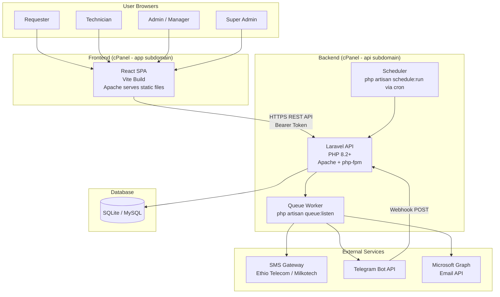
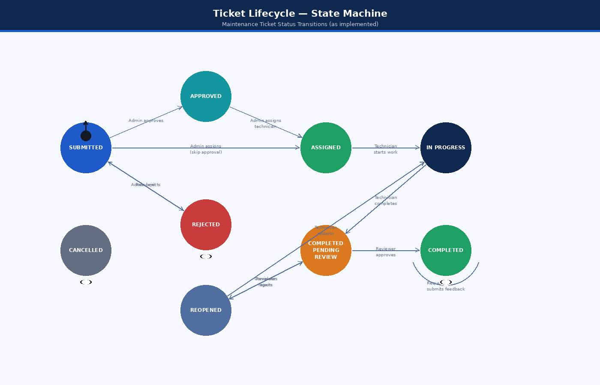
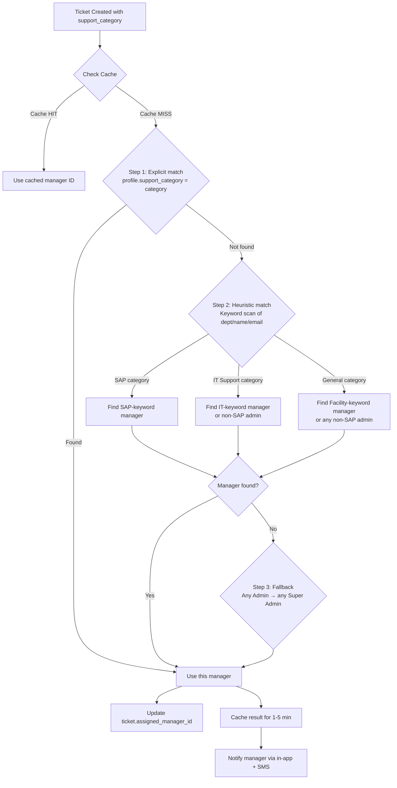
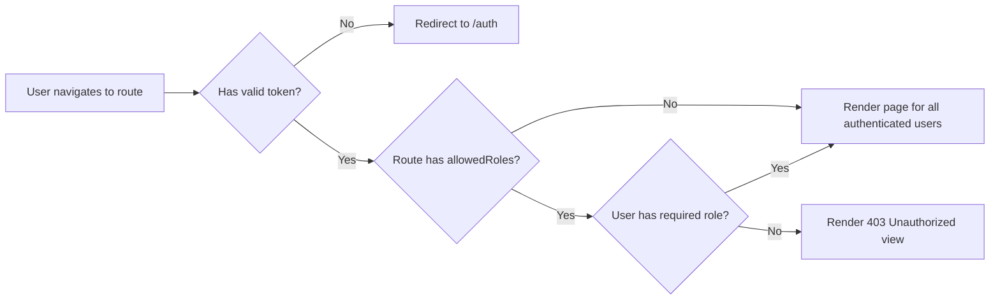
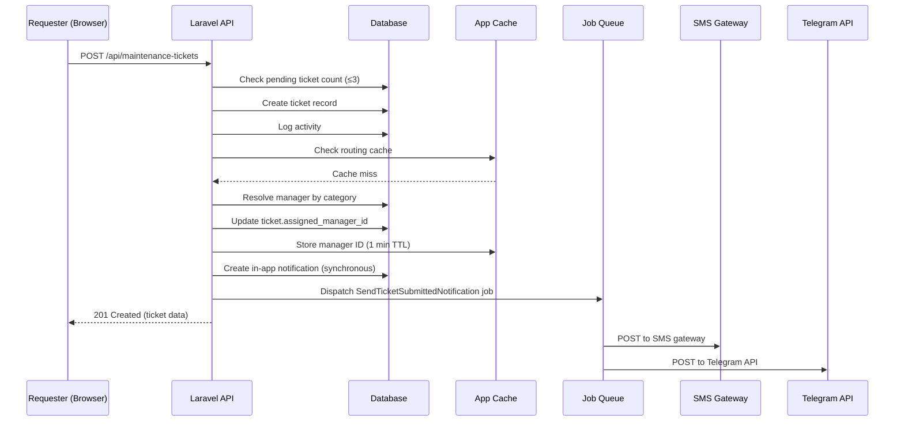
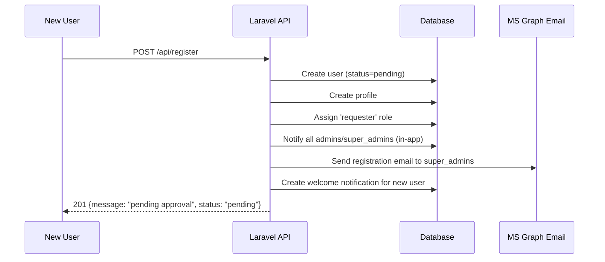
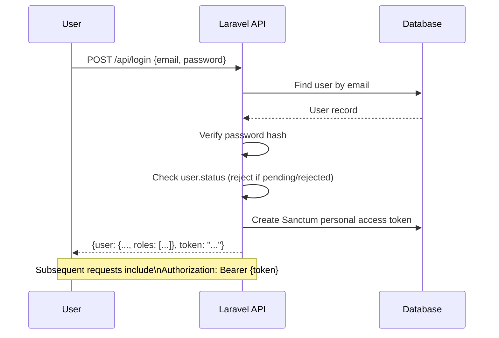

# System Design Document (SDD)

**Document Title:** System Design Document  
**System Name:** EEC IT Asset & Ticket Management System  
**Version:** 1.0  
**Date:** October 2026  
**Status:** Based on Implemented Codebase

---

## Table of Contents

1. [Design Overview](#1-design-overview)
2. [System Architecture Design](#2-system-architecture-design)
3. [Backend Module Design](#3-backend-module-design)
4. [Frontend Module Design](#4-frontend-module-design)
5. [Data Design](#5-data-design)
6. [Interface Design](#6-interface-design)
7. [Component Interactions](#7-component-interactions)
8. [Security Design](#8-security-design)
9. [Queue and Async Design](#9-queue-and-async-design)
10. [Caching Design](#10-caching-design)

---

## 1. Design Overview

### 1.1 Design Philosophy

The system follows a **decoupled, API-first** design philosophy:

- The **backend** (Laravel) is a pure REST API that serves JSON; it has no awareness of the frontend technology.
- The **frontend** (React SPA) consumes the API and renders the user interface.
- Communication is stateless, authenticated via Bearer tokens (Laravel Sanctum).
- **Business logic** lives exclusively in the backend. The frontend is responsible only for presentation and user interaction.

### 1.2 Design Patterns Used

| Pattern | Where Applied |
|---------|--------------|
| **Repository-via-Service** | `NotificationService`, `ActivityLogger`, `UserApprovalService`, `SmsService`, `TelegramService`, `MicrosoftGraphService` |
| **Policy-based Authorization** | `MaintenanceTicketPolicy`, `AssetPolicy` via Laravel Gates |
| **Observer / Event** | Laravel queue jobs for async notifications (`SendTicketSubmittedNotification`, etc.) |
| **Strategy Pattern** | SMS service drivers (`log` vs `api`), SMS auth modes (`body`, `bearer`, `header`, `basic`, `none`) |
| **Cache-Aside** | Manager routing cache keyed by support category |
| **RBAC** | Spatie Laravel Permission library for roles and permissions |
| **SPA with Client-Side Routing** | React Router v6 for all frontend navigation |
| **Provider Pattern** | React `AuthProvider`, `QueryClientProvider`, `ThemeProvider` for global state |

---

## 2. System Architecture Design

### 2.1 High-Level Architecture



### 2.2 Deployment Topology

```
cPanel Hosting Server
├── api.yourdomain.com/          → document root: .../asset-task-sync-backend/public/
│   ├── app/                     Laravel application
│   ├── database/                SQLite file or MySQL connection config
│   ├── storage/                 Logs, uploaded files, framework cache
│   └── public/                  Apache document root (index.php)
│
└── app.yourdomain.com/          → document root: .../app.yourdomain.com/
    ├── index.html               React SPA entry point
    ├── assets/                  Compiled JS/CSS chunks
    └── .htaccess                SPA fallback routing rule
```

---

## 3. Backend Module Design

### 3.1 Module Structure

```
app/
├── Console/                  Artisan commands
├── Http/
│   ├── Controllers/
│   │   └── Api/              12 API controllers
│   └── Middleware/           Authentication middleware
├── Jobs/                     6 queued notification jobs
├── Mail/                     NewUserRegistrationMail
├── Models/                   10 Eloquent models
├── Notifications/            (empty - using Jobs + Services instead)
├── Policies/                 AssetPolicy, MaintenanceTicketPolicy
├── Providers/                AppServiceProvider
└── Services/                 6 service classes
```

### 3.2 Controller Responsibilities

| Controller | Responsibility |
|-----------|---------------|
| `AuthController` | Registration, login, logout, user retrieval, password update, admin user creation, user approval/rejection |
| `AssetController` | CRUD for assets, CSV import, filtering/search |
| `MaintenanceTicketController` | Full ticket lifecycle: CRUD + approve, reject, assign, start, updateProgress, complete, reviewCompletion, submitFeedback, transfer; smart routing |
| `MaintenanceScheduleController` | CRUD for preventive maintenance schedules |
| `ProfileController` | CRUD for user profiles, role update |
| `NotificationController` | List, mark-read, mark-all-read, delete notifications |
| `ActivityLogController` | List activity logs (admin-only) |
| `ReportController` | Ticket report, asset report, performance report, CSV exports |
| `FaqController` | CRUD for FAQs, keyword-based chatbot assist |
| `LocationController` | CRUD for locations, CSV import, list profiles per location |
| `DepartmentController` | CRUD for departments, CSV import |
| `TelegramWebhookController` | Webhook handler, generate link token, unlink, status check |

### 3.3 Service Layer Design

```mermaid
classDiagram
    class NotificationService {
        +create(userId, title, message, type, link)
        +sms(userId, message)
        +ticketSubmitted(ticket, managerId, categoryLabel, userId)
        +ticketApproved(ticket)
        +ticketRejected(ticket, reason)
        +ticketAssigned(ticket, technicianId)
        +ticketCompletedPendingReview(ticket, userId)
        +ticketReopened(ticket, userId)
    }

    class ActivityLogger {
        +log(action, modelType, modelId, description)
    }

    class SmsService {
        +enabled() bool
        +send(phone, message) bool
        +normalizePhone(phone) string|null
    }

    class TelegramService {
        +sendMessage(chatId, message) bool
        +sendApprovalNotification(user) bool
        +generateLinkToken(userId) array
        +verifyAndLinkChatId(token, chatId, username) array
        +unlinkAccount(userId) bool
    }

    class MicrosoftGraphService {
        +getAccessToken() string
        +sendEmail(toEmail, subject, htmlBody) bool
    }

    class UserApprovalService {
        +approveIfPending(user) void
        +registrationPendingMessage() string
    }
```



### 3.4 Ticket State Machine



*Figure: Ticket Lifecycle — Status State Machine*

### 3.5 Smart Ticket Routing Algorithm

When a ticket is submitted, the system resolves the correct manager through a 3-step cascade:



---

## 4. Frontend Module Design

### 4.1 Application Structure

```
src/
├── App.tsx                   Root component, routing, providers
├── pages/                    17 page components (lazy-loaded)
│   ├── Auth.tsx              Login, register, pending state
│   ├── Index.tsx             Dashboard
│   ├── Assets.tsx            Asset management
│   ├── Requests.tsx          Ticket submission (Requester view)
│   ├── Tickets.tsx           Ticket management (Tech/Admin view)
│   ├── Users.tsx             User management (Admin)
│   ├── Reports.tsx           Analytics and charts
│   ├── Schedules.tsx         Preventive maintenance schedules
│   ├── Calendar.tsx          Calendar view of tickets/schedules
│   ├── Notifications.tsx     Notification center
│   ├── Settings.tsx          User/system settings
│   ├── Locations.tsx         Location management
│   ├── Departments.tsx       Department management
│   ├── Faqs.tsx              FAQ management (Admin)
│   ├── Help.tsx              Help center (all users) + Chatbot
│   ├── ActivityLogs.tsx      Audit log viewer
│   └── NotFound.tsx          404 page
├── components/
│   ├── auth/                 SessionTimeoutHandler
│   ├── dashboard/            Dashboard widgets
│   ├── layout/               MainLayout, Sidebar, PageLoader
│   ├── tickets/              Ticket-specific sub-components
│   ├── skeletons/            Loading skeleton components
│   ├── ui/                   Shadcn/UI component library
│   ├── ChatBot.tsx           Floating chatbot widget
│   ├── NavLink.tsx           Sidebar navigation link
│   └── ProtectedRoute.tsx    Auth guard with role restriction
├── hooks/
│   └── useAuth.tsx           Auth context provider + hook
├── integrations/
│   └── laravel/
│       └── client.ts         Axios instance with base URL + interceptors
├── types/                    TypeScript type definitions
├── data/                     Static data (if any)
└── lib/                      Utility functions
```

### 4.2 State Management

| State Layer | Technology | Used For |
|-------------|-----------|---------|
| Global Auth State | React Context (`AuthProvider`) | Current user, token, role |
| Server State | TanStack Query (React Query) | API data fetching, caching, invalidation |
| Form State | React Hook Form + Zod | All forms with validation |
| UI State | React `useState` | Modals, filters, local toggles |
| Theme | `next-themes` | Dark/light mode |

### 4.3 Route Access Control



**Protected Routes by Role:**

| Route | Accessible By |
|-------|--------------|
| `/` | All authenticated |
| `/assets` | All authenticated |
| `/requests` | All authenticated |
| `/tickets` | All authenticated |
| `/calendar` | All authenticated |
| `/notifications` | All authenticated |
| `/settings` | All authenticated |
| `/help` | All authenticated |
| `/users` | admin only |
| `/locations` | admin only |
| `/departments` | admin only |
| `/faqs` | admin only |
| `/schedules` | admin only |
| `/activity-logs` | admin only |
| `/reports` | admin and technician |

> Note: In the frontend, `allowedRoles={['admin']}` matches both `admin` and `super_admin` roles based on the `ProtectedRoute` logic.

### 4.4 API Client Design

The frontend uses a single Axios instance configured in `src/integrations/laravel/client.ts` with:
- Base URL from `VITE_API_URL` environment variable
- Request interceptor: automatically attaches `Authorization: Bearer {token}` from `localStorage`
- Response interceptor: handles 401 responses by clearing auth state and redirecting to `/auth`

---

## 5. Data Design

See [04_Database.md](./04_Database.md) for the complete ER diagram and table specifications.

### 5.1 Key Design Decisions

| Decision | Rationale |
|---------|----------|
| **UUID primary keys** for core entities | Prevents enumeration attacks, enables distributed ID generation |
| **Integer IDs** for users | Compatibility with Spatie Permission library which expects integer user IDs |
| **JSON columns** for `spare_parts` and `images` | Flexible storage for variable-length arrays without junction tables |
| **Separate `profiles` table** | Decouples Sanctum/auth user data from business profile data |
| **`support_category` on profiles** | Enables intelligent routing without complex heuristic queries at every request |
| **Database-based cache/queue/session** | Suitable for shared hosting without Redis or Memcached |

---

## 6. Interface Design

### 6.1 API Communication Protocol

- **Format:** JSON (REST)
- **Auth:** Bearer token in `Authorization` header
- **Error Format:**
  ```json
  {
    "message": "Human-readable error description",
    "errors": { "field": ["Validation error message"] }
  }
  ```
- **Success Format (resource):**
  ```json
  { ...resource fields... }
  ```
- **Success Format (collection):**
  ```json
  [ { ...resource... }, { ...resource... } ]
  ```
- **HTTP Status Codes:** 200 (OK), 201 (Created), 204 (No Content), 400 (Bad Request), 401 (Unauthorized), 403 (Forbidden), 404 (Not Found), 422 (Validation Error), 500 (Server Error)

---

## 7. Component Interactions

### 7.1 Ticket Submission Flow



### 7.2 User Registration Flow



---

## 8. Security Design

### 8.1 Authentication Flow



### 8.2 Authorization Layers

Three layers of authorization protect API endpoints:

1. **Middleware (`auth:sanctum`):** Validates Bearer token; returns 401 if invalid.
2. **Role Check:** Manual `$user->hasAnyRole(['admin', 'super_admin'])` checks in controllers.
3. **Policy/Gate:** `Gate::authorize('create', Asset::class)` delegates to `AssetPolicy` / `MaintenanceTicketPolicy`.

### 8.3 Data Privacy

- Feedback comments are hidden from technicians via `makeHidden('feedback_comment')`.
- Passwords are never returned in API responses (hidden in User model).
- Personal access tokens are never stored in plain text (hashed by Sanctum).

---

## 9. Queue and Async Design

### 9.1 Queue Architecture

The system uses Laravel's database-backed queue (`QUEUE_CONNECTION=database`).

**Queued Jobs:**

| Job | Trigger | Payload |
|-----|---------|---------|
| `SendTicketSubmittedNotification` | Ticket creation | ticket, managerId, categoryLabel, userId |
| `SendTicketApprovalNotification` | Ticket approval | ticket (sends MS Graph email) |
| `SendTicketApprovedNotification` | Ticket approval | ticket, approver name (sends Telegram) |
| `SendTicketAssignedNotification` | Technician assignment | ticket, technicianProfileId |
| `SendTicketRejectedNotification` | Ticket rejection | ticket, rejection reason |
| `SendSmsNotification` | Any SMS event | userId, message |

### 9.2 Synchronous vs. Asynchronous Notifications

| Notification Type | Delivery | Reason |
|------------------|----------|--------|
| In-app (database) | **Synchronous** | Ensures delivery even when no queue worker runs |
| SMS | **Asynchronous (queued)** | External HTTP call — cannot block user request |
| Telegram | **Asynchronous (queued)** | External HTTP call — cannot block user request |
| Email (MS Graph) | **Asynchronous (queued)** | External HTTPS call — cannot block user request |

---

## 10. Caching Design

### 10.1 Cache Store

`CACHE_STORE=database` — Uses the `cache` table in the database (suitable for shared hosting).

### 10.2 Cached Keys

| Cache Key | TTL | Content | Invalidated When |
|-----------|-----|---------|-----------------|
| `ticket_routing.manager.it_support` | 1–5 minutes | User ID of IT Support manager | User role changes, user creation |
| `ticket_routing.manager.sap` | 1–5 minutes | User ID of SAP manager | User role changes, user creation |
| `ticket_routing.manager.general` | 1–5 minutes | User ID of General/Facility manager | User role changes, user creation |
| `ms_graph_access_token` | 3,300 seconds | Microsoft Graph OAuth2 access token | Expiry (auto-refresh) |
| `telegram_link_token:{token}` | 15 minutes | User ID for Telegram deep-link | Token use or expiry |
