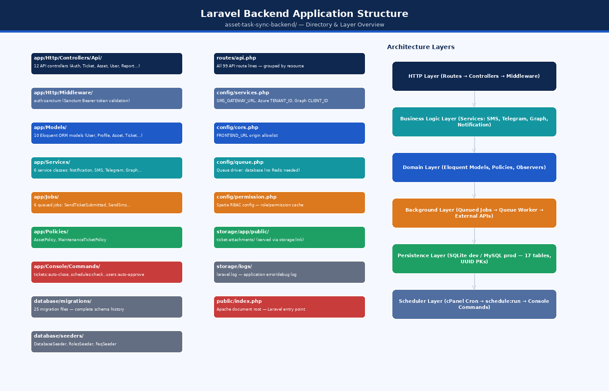
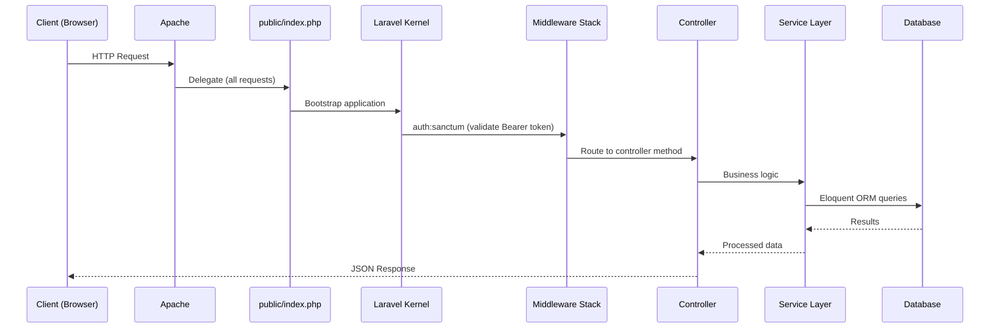
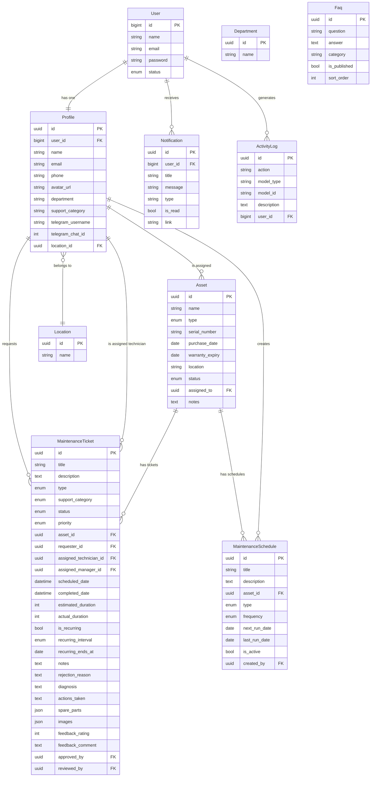
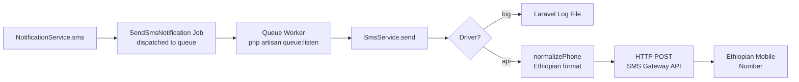
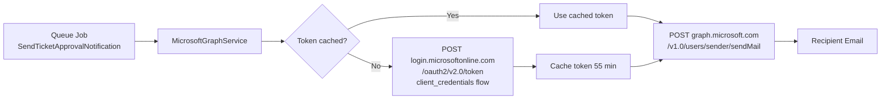
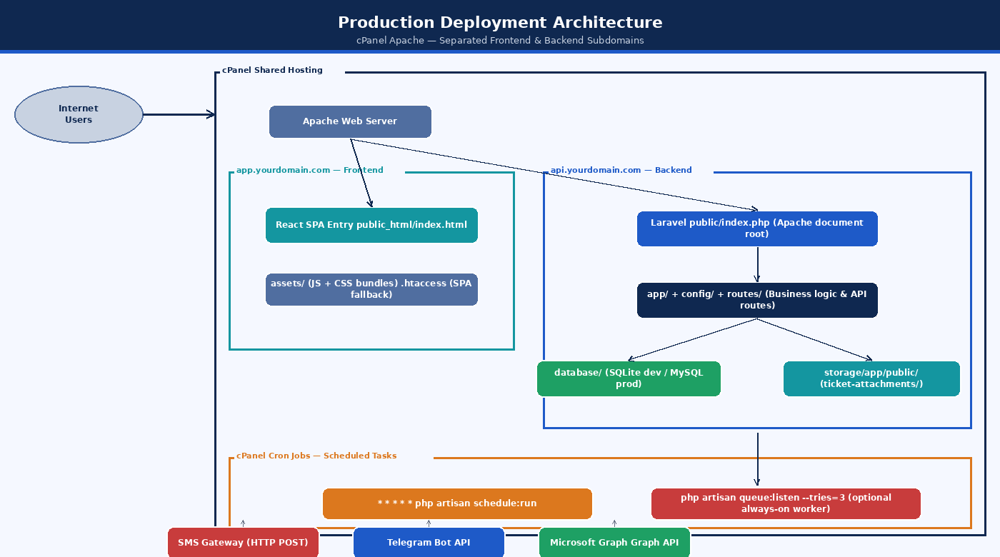
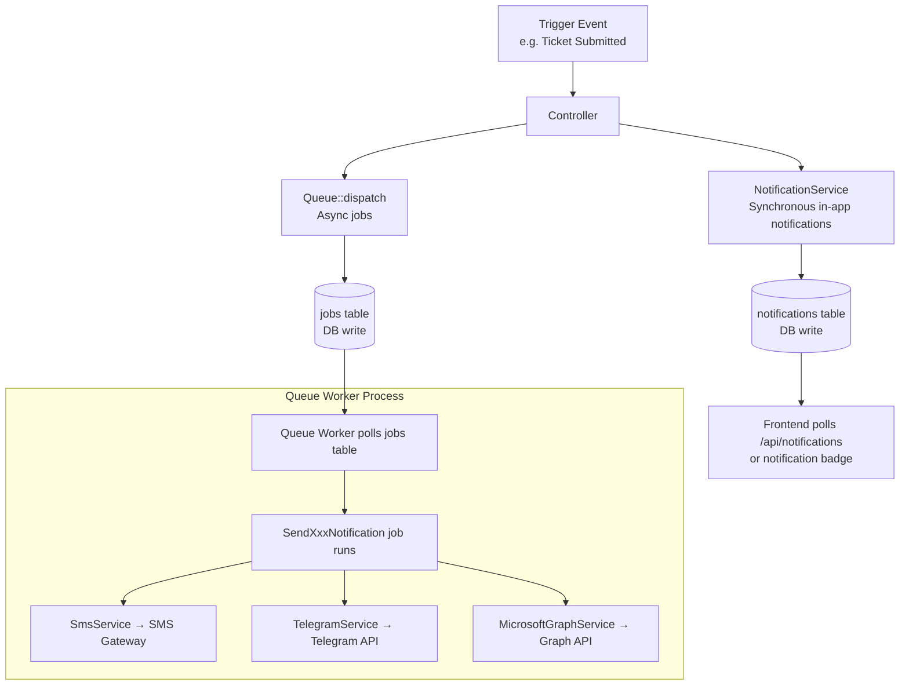
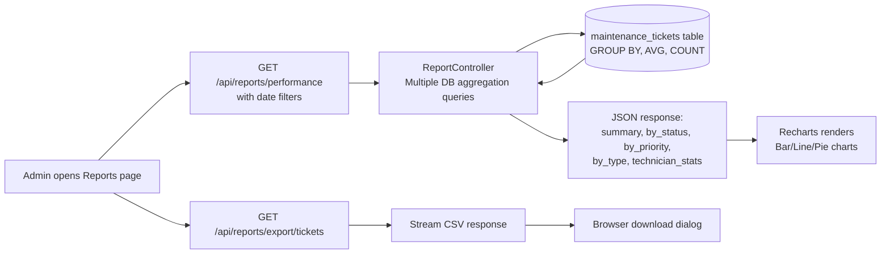
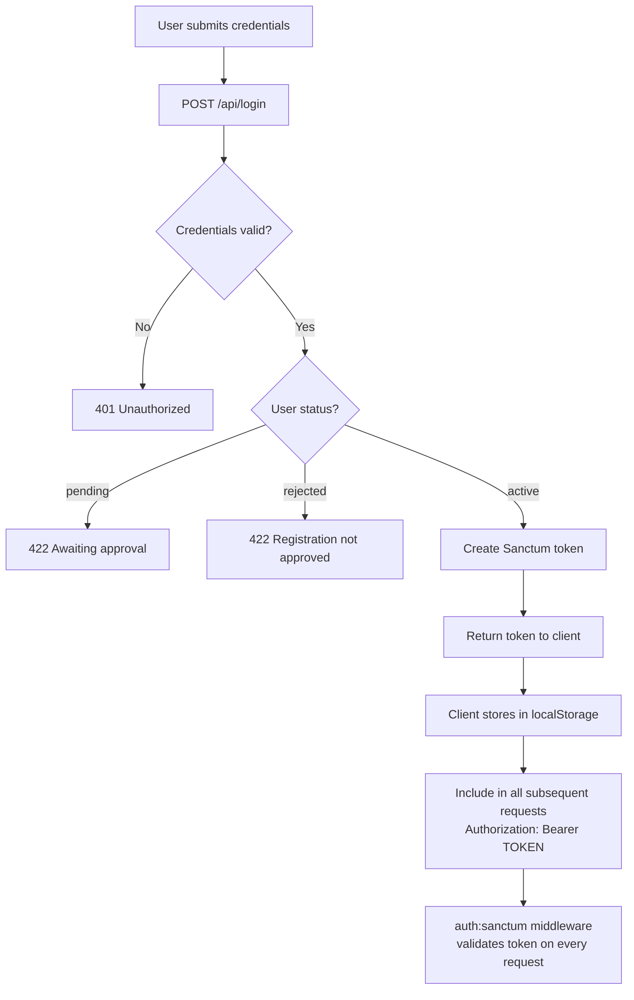
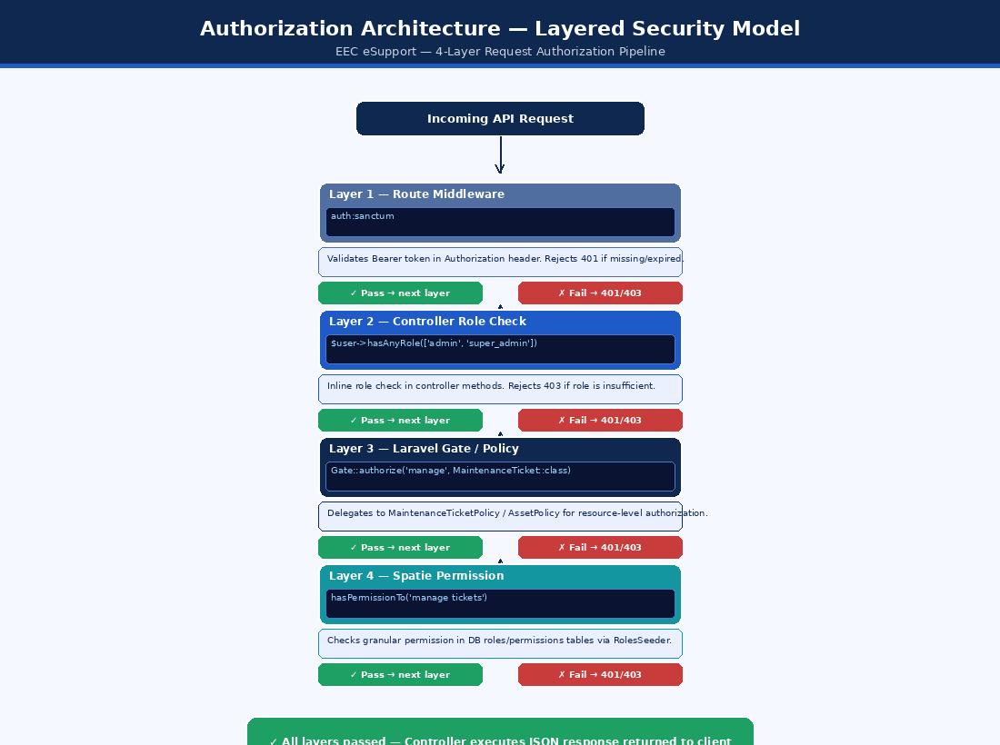

# System Architecture Documentation

**Document Title:** System Architecture Documentation  
**System Name:** EEC IT Asset & Ticket Management System  
**Version:** 1.0  
**Date:** October 2026  
**Status:** Based on Implemented Codebase

---

## Table of Contents

1. [Architecture Overview](#1-architecture-overview)
2. [Technology Stack](#2-technology-stack)
3. [Backend Architecture (Laravel)](#3-backend-architecture-laravel)
4. [Frontend Architecture (React SPA)](#4-frontend-architecture-react-spa)
5. [Integration Architecture](#5-integration-architecture)
6. [Infrastructure Architecture](#6-infrastructure-architecture)
7. [Data Flow Architecture](#7-data-flow-architecture)
8. [Security Architecture](#8-security-architecture)

---

## 1. Architecture Overview

The EEC IT Asset & Ticket Management System follows a **two-tier decoupled architecture**:

| Tier | Technology | Role |
|------|-----------|------|
| Presentation Tier | React 18 SPA (TypeScript, Vite) | User interface, client-side routing, state management |
| Application/Data Tier | Laravel 12 REST API (PHP 8.2+) | Business logic, authentication, database, external integrations |

**Key Architectural Decisions:**

1. **Stateless REST API** — No server-side sessions; authentication via Bearer tokens only.
2. **SPA Frontend** — The React app is a compiled static bundle served by Apache. No Node.js server is needed at runtime.
3. **Database-backed async** — Queues, sessions, and cache all use the database, making the system compatible with shared hosting without Redis.
4. **Separated deployment** — Frontend and backend run on separate subdomains, enabling independent scaling and deployment.

---

## 2. Technology Stack

### 2.1 Backend Stack

| Component | Technology | Version |
|-----------|-----------|---------|
| Language | PHP | 8.2+ |
| Framework | Laravel | 12.x |
| Authentication | Laravel Sanctum | 4.x |
| Authorization | Spatie Laravel Permission | 6.x |
| Database (dev) | SQLite | 3.x |
| Database (prod) | MySQL | 8.0+ |
| Queue | Laravel Database Queue | Built-in |
| Cache | Laravel Database Cache | Built-in |
| File Storage | Laravel Local Disk | Built-in |
| Task Scheduling | Laravel Scheduler (cron) | Built-in |
| Email | Microsoft Graph API | v1.0 |
| SMS | Configurable HTTP Gateway | — |
| Telegram | Telegram Bot API | — |
| HTTP Client | Guzzle / Laravel Http | Built-in |

### 2.2 Frontend Stack

| Component | Technology | Version |
|-----------|-----------|---------|
| Language | TypeScript | 5.x |
| Framework | React | 18.x |
| Build Tool | Vite | 5.x |
| Routing | React Router DOM | 6.x |
| State (Server) | TanStack Query (React Query) | 5.x |
| Forms | React Hook Form + Zod | 7.x / 3.x |
| UI Components | Shadcn/UI + Radix UI | Latest |
| Styling | TailwindCSS | 3.x |
| Charts | Recharts | 2.x |
| HTTP Client | Axios | 1.x |
| Icons | Lucide React | Latest |
| Notifications | Sonner | 1.x |
| Date Utilities | date-fns | 3.x |

### 2.3 DevOps / Infrastructure

| Component | Technology |
|-----------|-----------|
| Web Server | Apache (mod_rewrite) |
| Hosting | cPanel shared hosting |
| Process Manager | (None — queue worker managed via cPanel cron or Terminal) |
| CI/CD | GitHub + cPanel Git Version Control (optional) |
| SSL | cPanel AutoSSL / Let's Encrypt |

---

## 3. Backend Architecture (Laravel)

### 3.1 Laravel Application Structure

```
asset-task-sync-backend/
├── app/
│   ├── Console/
│   │   └── Commands/           Artisan console commands
│   ├── Http/
│   │   ├── Controllers/Api/    12 API controllers
│   │   └── Middleware/         auth:sanctum (built-in)
│   ├── Jobs/                   6 queued notification jobs
│   ├── Mail/                   NewUserRegistrationMail Mailable
│   ├── Models/                 10 Eloquent ORM models
│   ├── Policies/               AssetPolicy, MaintenanceTicketPolicy
│   ├── Providers/              AppServiceProvider (policy registration)
│   └── Services/               6 service classes (business logic)
├── bootstrap/                  Framework bootstrap + cache
├── config/                     All configuration files
│   ├── app.php
│   ├── auth.php
│   ├── cors.php
│   ├── database.php
│   ├── queue.php
│   ├── services.php            SMS + Azure Graph credentials
│   └── permission.php          Spatie RBAC config
├── database/
│   ├── migrations/             25 migration files
│   └── seeders/                3 seeders (DB, Roles, FAQs)
├── public/                     Apache document root (index.php)
├── routes/
│   ├── api.php                 99 lines, all API routes
│   ├── console.php             Scheduled commands
│   └── web.php                 Single catch-all (Sanctum CSRF)
└── storage/
    ├── app/public/             Uploaded ticket attachments
    └── logs/                   laravel.log
```



*Figure: Laravel Backend Application Structure & Architecture Layers*


### 3.2 Request Lifecycle



### 3.3 Model Relationships



---

## 4. Frontend Architecture (React SPA)

### 4.1 Component Architecture

```mermaid
graph TD
    A[App.tsx\nRoot Provider] --> B[BrowserRouter]
    A --> C[QueryClientProvider]
    A --> D[TooltipProvider]
    A --> E[Toaster / Sonner]

    B --> F[AuthProvider\nContext]
    F --> G[SessionTimeoutHandler]
    F --> H[Suspense + Routes]

    H --> I[/auth → Auth.tsx\nPublic Route]
    H --> J[ProtectedRoute\nAuth Guard]

    J --> K[Index.tsx\nDashboard]
    J --> L[Assets.tsx]
    J --> M[Requests.tsx]
    J --> N[Tickets.tsx]
    J --> O[Users.tsx]
    J --> P[Reports.tsx]
    J --> Q[...12 more pages]

    K & L & M & N --> R[MainLayout\nSidebar + Header]
    R --> S[ChatBot.tsx\nFloating Widget]
```

### 4.2 Data Fetching Pattern

All API data is managed through **TanStack Query**:

```typescript
// Pattern used across all pages:
const { data, isLoading, error } = useQuery({
  queryKey: ['resource', filters],
  queryFn: () => api.get('/resource').then(r => r.data),
  staleTime: 5 * 60 * 1000,
});

// Mutations with cache invalidation:
const mutation = useMutation({
  mutationFn: (data) => api.post('/resource', data),
  onSuccess: () => {
    queryClient.invalidateQueries({ queryKey: ['resource'] });
  },
});
```

### 4.3 Authentication Context

The `useAuth` hook provides throughout the app:
- `user` — current authenticated user object (with roles and profile)
- `token` — Bearer token stored in `localStorage`
- `login(credentials)` — calls `/api/login`, stores token
- `logout()` — calls `/api/logout`, clears token
- `hasRole(role)` — checks user role
- `isAuthenticated` — boolean

---

## 5. Integration Architecture

### 5.1 SMS Integration



**Phone Normalization:** Accepts `0912345678`, `912345678`, `+251912345678`, `251912345678`. Outputs in `251XXXXXXXXX` format. Only validates Ethiopian Ethio Telecom (09x) and Safaricom ET (07x) numbers.

### 5.2 Telegram Integration

```mermaid
flowchart TB
    subgraph "Account Linking"
        A[User requests link] --> B[POST /api/telegram/generate-link]
        B --> C[Token cached 15 min]
        C --> D[Deep link t.me/bot?start=TOKEN]
        D --> E[User clicks → opens Telegram bot]
        E --> F[Bot receives /start TOKEN]
        F --> G[POST /api/telegram/webhook]
        G --> H[verifyAndLinkChatId\nsave chat_id to profile]
    end

    subgraph "Notifications"
        I[Queue Job] --> J[TelegramService.sendMessage]
        J --> K[POST api.telegram.org/bot{TOKEN}/sendMessage]
        K --> L[User's Telegram App]
    end
```

### 5.3 Microsoft Graph Email Integration



---

## 6. Infrastructure Architecture

### 6.1 Production Deployment Architecture

```
Internet
    │
    ├─→ app.yourdomain.com  ─→  Apache vhost
    │                            └── public_html/
    │                                 ├── index.html  (React SPA entry)
    │                                 ├── assets/     (JS/CSS bundles)
    │                                 └── .htaccess   (SPA routing fallback)
    │
    └─→ api.yourdomain.com  ─→  Apache vhost
                                  document root: /backend/public/
                                  └── index.php  (Laravel entry)
                                       └── app/
                                       └── database/ (SQLite or MySQL)
                                       └── storage/
                                            ├── logs/
                                            └── app/public/ (attachments)
```



*Figure: Production Deployment Architecture — cPanel Apache Hosting*


### 6.2 Queue Worker Architecture

```
cPanel Cron Job (every minute):
* * * * * php artisan schedule:run

Optional always-on worker:
php artisan queue:listen --tries=3 --delay=3
```

> **Note:** On shared cPanel hosting, the queue worker typically runs as a cPanel cron job polling every minute, not as a persistent daemon.

### 6.3 File Storage

Uploaded ticket attachments are stored in `storage/app/public/ticket-attachments/` and served via a symbolic link from `public/storage/`.

```bash
php artisan storage:link
# Creates: public/storage → storage/app/public
```

---

## 7. Data Flow Architecture

### 7.1 Notification Data Flow



### 7.2 Report Data Flow



---

## 8. Security Architecture

### 8.1 Authentication Architecture



### 8.2 CORS Architecture

Laravel's CORS middleware (configured in `config/cors.php`) restricts cross-origin requests:

- **Allowed Origins:** `FRONTEND_URL` environment variable
- **Allowed Methods:** GET, POST, PUT, PATCH, DELETE, OPTIONS
- **Allowed Headers:** Content-Type, Authorization, X-Requested-With
- **Credentials:** Supported

### 8.3 Authorization Architecture (Layered)

```
Layer 1: Route Middleware
    auth:sanctum → validates Bearer token
         ↓
Layer 2: Controller Role Check
    $user->hasAnyRole(['admin', 'super_admin'])
         ↓
Layer 3: Laravel Gate / Policy
    Gate::authorize('manage', MaintenanceTicket::class)
    → delegates to MaintenanceTicketPolicy::manage()
    → checks hasPermissionTo('manage tickets')
```



*Figure: Authorization Architecture — 4-Layer Security Pipeline*


### 8.4 Password Security

- **Algorithm:** bcrypt with 12 rounds (`BCRYPT_ROUNDS=12` in `.env`)
- **Cast:** Laravel's `hashed` cast on `User::password` auto-hashes on assignment
- **Protection:** Password field is in `$hidden` array; never returned in API responses
