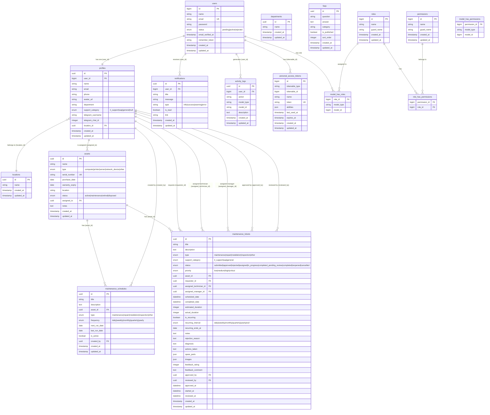

# Database Design and ER Diagram

**Document Title:** Database Design and Entity-Relationship Diagram  
**System Name:** EEC IT Asset & Ticket Management System  
**Version:** 1.0  
**Date:** October 2026  
**Status:** Based on Implemented Migrations

---

## Table of Contents

1. [Database Overview](#1-database-overview)
2. [Entity-Relationship Diagram](#2-entity-relationship-diagram)
3. [Table Specifications](#3-table-specifications)
4. [Indexes and Performance](#4-indexes-and-performance)
5. [Migration History](#5-migration-history)

---

## 1. Database Overview

### 1.1 Database Engine

| Environment | Engine | Notes |
|-------------|--------|-------|
| Development | SQLite | File: `database/database.sqlite` |
| Production | MySQL 8.0+ | Configured via `DB_*` environment variables |

### 1.2 Primary Key Strategy

| Table Group | PK Type | Reason |
|-------------|---------|--------|
| Core domain tables (assets, tickets, profiles, etc.) | **UUID (v4)** | Prevents enumeration, safe for distributed systems |
| Auth / System tables (users, jobs, cache) | **Auto-increment BIGINT** | Laravel defaults; Spatie Permission requires integer user IDs |

### 1.3 Naming Conventions

- Table names: `snake_case`, plural
- Column names: `snake_case`
- Foreign keys: `{referenced_table_singular}_id`
- Enum values: `snake_case` strings

### 1.4 Total Table Count

The system has **17 tables** (10 domain tables + 7 system/framework tables):

**Domain Tables:** `users`, `profiles`, `assets`, `maintenance_tickets`, `maintenance_schedules`, `notifications`, `activity_logs`, `locations`, `departments`, `faqs`

**System Tables:** `personal_access_tokens`, `permissions`, `roles`, `model_has_permissions`, `model_has_roles`, `role_has_permissions`, `jobs`, `cache`, `sessions`

---

## 2. Entity-Relationship Diagram

---

## 3. Table Specifications

### 3.1 `users`

Stores authentication credentials and account status.

| Column | Type | Constraints | Description |
|--------|------|-------------|-------------|
| `id` | BIGINT UNSIGNED | PK, AUTO_INCREMENT | System-generated identifier |
| `name` | VARCHAR(255) | NOT NULL | Full display name |
| `email` | VARCHAR(255) | UNIQUE, NOT NULL | Login email (normalized to lowercase) |
| `password` | VARCHAR(255) | NOT NULL | bcrypt hashed password (12 rounds) |
| `status` | ENUM | NOT NULL, DEFAULT `active` | `pending`, `active`, `rejected` |
| `email_verified_at` | TIMESTAMP | NULL | Email verification timestamp (not enforced in current UI) |
| `remember_token` | VARCHAR(100) | NULL | For "remember me" (not used in API) |
| `created_at` | TIMESTAMP | NOT NULL | Record creation time |
| `updated_at` | TIMESTAMP | NOT NULL | Last update time |

**Default Seeded Users** (change passwords on deployment):

| Role | Email | Password |
|------|-------|---------|
| Super Admin | superadmin@example.com | password |
| Admin | admin@example.com | password |
| Technician | technician@example.com | password |
| Requester | requester@example.com | password |

---

### 3.2 `profiles`

Extends user accounts with business profile data.

| Column | Type | Constraints | Description |
|--------|------|-------------|-------------|
| `id` | CHAR(36) | PK, UUID | Profile identifier |
| `user_id` | BIGINT UNSIGNED | FK → users.id, UNIQUE | One-to-one with users |
| `name` | VARCHAR(255) | NOT NULL | Display name (copied from registration) |
| `email` | VARCHAR(255) | NOT NULL | Email (copied from registration) |
| `phone` | VARCHAR(30) | NULL | Ethiopian mobile number for SMS |
| `avatar_url` | VARCHAR(255) | NULL | Profile picture URL |
| `department` | VARCHAR(255) | NULL | Department name (free text) |
| `support_category` | ENUM | NULL | `it_support`, `sap`, `general` — determines routing |
| `telegram_username` | VARCHAR(255) | NULL | Telegram handle (without @) |
| `telegram_chat_id` | INTEGER | NULL | Telegram chat ID (set after bot link) |
| `location_id` | CHAR(36) | FK → locations.id, NULL | Associated physical location |
| `created_at` | TIMESTAMP | — | — |
| `updated_at` | TIMESTAMP | — | — |

**Notes:**
- The `support_category` column on manager/admin profiles is the primary key for smart ticket routing.
- `telegram_chat_id` is populated only after the user links their account via the Telegram bot.

---

### 3.3 `assets`

IT asset inventory registry.

| Column | Type | Constraints | Description |
|--------|------|-------------|-------------|
| `id` | CHAR(36) | PK, UUID | Asset identifier |
| `name` | VARCHAR(255) | NOT NULL | Asset name/label |
| `type` | ENUM | NOT NULL | `computer`, `printer`, `server`, `network_device`, `other` |
| `serial_number` | VARCHAR(255) | UNIQUE, NOT NULL | Manufacturer serial number |
| `purchase_date` | DATE | NOT NULL | When the asset was acquired |
| `warranty_expiry` | DATE | NULL | Warranty end date |
| `location` | VARCHAR(255) | NOT NULL | Physical location (free text) |
| `status` | ENUM | DEFAULT `active` | `active`, `maintenance`, `retired`, `disposed` |
| `assigned_to` | CHAR(36) | FK → profiles.id, NULL, SET NULL on delete | Assigned user |
| `notes` | TEXT | NULL | Additional notes |
| `created_at` | TIMESTAMP | — | — |
| `updated_at` | TIMESTAMP | — | — |

**Indexes:** `status`, `type`

---

### 3.4 `maintenance_tickets`

Core table tracking all support/maintenance requests through their full lifecycle.

| Column | Type | Constraints | Description |
|--------|------|-------------|-------------|
| `id` | CHAR(36) | PK, UUID | Ticket identifier |
| `title` | VARCHAR(255) | NOT NULL | Brief summary |
| `description` | TEXT | NULL | Detailed description |
| `type` | ENUM | NOT NULL | `maintenance`, `repair`, `installation`, `inspection`, `other` |
| `support_category` | ENUM | DEFAULT `general` | `it_support`, `sap`, `general` |
| `status` | ENUM | DEFAULT `submitted` | See state machine in SDD |
| `priority` | ENUM | DEFAULT `medium` | `low`, `medium`, `high`, `critical` |
| `asset_id` | CHAR(36) | FK → assets.id, NULL, CASCADE on delete | Associated asset (optional since migration `2026_07_18`) |
| `requester_id` | CHAR(36) | FK → profiles.id, NULL, SET NULL | Who submitted |
| `assigned_technician_id` | CHAR(36) | FK → profiles.id, NULL, SET NULL | Assigned technician |
| `assigned_manager_id` | CHAR(36) | FK → profiles.id, NULL | Auto-routed manager |
| `scheduled_date` | DATETIME | NOT NULL | Planned service date |
| `completed_date` | DATETIME | NULL | Actual completion date |
| `estimated_duration` | INTEGER | NULL | In minutes |
| `actual_duration` | INTEGER | NULL | In minutes |
| `is_recurring` | BOOLEAN | DEFAULT false | Recurring ticket flag |
| `recurring_interval` | ENUM | NULL | `daily`, `weekly`, `monthly`, `quarterly`, `yearly` |
| `recurring_ends_at` | DATE | NULL | When recurring ends |
| `notes` | TEXT | NULL | General notes / review notes appended |
| `rejection_reason` | TEXT | NULL | Required when status = rejected |
| `diagnosis` | TEXT | NULL | Technician's diagnosis |
| `actions_taken` | TEXT | NULL | Required on ticket completion |
| `spare_parts` | JSON | NULL | Array of parts used |
| `images` | JSON | NULL | Array of attachment metadata |
| `feedback_rating` | INTEGER | NULL | 1–5 star rating from requester |
| `feedback_comment` | TEXT | NULL | Confidential text feedback (hidden from technicians) |
| `approved_by` | CHAR(36) | FK → profiles.id, NULL, SET NULL | Manager who approved |
| `reviewed_by` | CHAR(36) | FK → profiles.id, NULL, SET NULL | Who reviewed completion |
| `approved_at` | DATETIME | NULL | When approved |
| `started_at` | DATETIME | NULL | When work began |
| `reviewed_at` | DATETIME | NULL | When completion was reviewed |
| `created_at` | TIMESTAMP | — | — |
| `updated_at` | TIMESTAMP | — | — |

**Indexes:** `status`, `priority`, `scheduled_date`, `assigned_technician_id`, `requester_id`, `support_category`, `asset_id`, `assigned_manager_id`

---

### 3.5 `maintenance_schedules`

Preventive maintenance schedule registry.

| Column | Type | Constraints | Description |
|--------|------|-------------|-------------|
| `id` | CHAR(36) | PK, UUID | Schedule identifier |
| `title` | VARCHAR(255) | NOT NULL | Schedule name |
| `description` | TEXT | NULL | Details |
| `asset_id` | CHAR(36) | FK → assets.id | Associated asset |
| `type` | ENUM | NOT NULL | Same as ticket types |
| `frequency` | ENUM | NOT NULL | `daily`, `weekly`, `monthly`, `quarterly`, `yearly` |
| `next_run_date` | DATE | NOT NULL | When the next occurrence is due |
| `last_run_date` | DATE | NULL | When last executed |
| `is_active` | BOOLEAN | DEFAULT true | Active/inactive flag |
| `created_by` | CHAR(36) | FK → profiles.id | Creator |
| `created_at` | TIMESTAMP | — | — |
| `updated_at` | TIMESTAMP | — | — |

---

### 3.6 `notifications`

In-app notification store.

| Column | Type | Constraints | Description |
|--------|------|-------------|-------------|
| `id` | CHAR(36) | PK, UUID | Notification identifier |
| `user_id` | BIGINT UNSIGNED | FK → users.id | Target user |
| `title` | VARCHAR(255) | NOT NULL | Short title |
| `message` | VARCHAR(255) | NOT NULL | Full message text |
| `type` | VARCHAR(255) | NOT NULL | `info`, `success`, `warning`, `error` |
| `is_read` | BOOLEAN | DEFAULT false | Read status |
| `link` | VARCHAR(255) | NULL | Deep link (e.g., `/tickets/{id}`) |
| `created_at` | TIMESTAMP | — | — |
| `updated_at` | TIMESTAMP | — | — |

**Deduplication Index:** Queries on `(user_id, title, created_at)` to suppress duplicate notifications within 60 seconds.

---

### 3.7 `activity_logs`

Audit trail for all significant system operations.

| Column | Type | Constraints | Description |
|--------|------|-------------|-------------|
| `id` | CHAR(36) | PK, UUID | Log identifier |
| `user_id` | BIGINT UNSIGNED | FK → users.id, NULL | User who performed the action |
| `action` | VARCHAR(255) | NOT NULL | Verb: `created`, `updated`, `deleted`, `approved`, etc. |
| `model_type` | VARCHAR(255) | NOT NULL | Entity type: `Ticket`, `Asset`, `Faq`, etc. |
| `model_id` | VARCHAR(255) | NULL | UUID of the affected entity |
| `description` | TEXT | NOT NULL | Human-readable description |
| `created_at` | TIMESTAMP | — | — |
| `updated_at` | TIMESTAMP | — | — |

---

### 3.8 `locations`

Physical location registry.

| Column | Type | Constraints | Description |
|--------|------|-------------|-------------|
| `id` | CHAR(36) | PK, UUID | Location identifier |
| `name` | VARCHAR(255) | NOT NULL | Location name |
| `created_at` | TIMESTAMP | — | — |
| `updated_at` | TIMESTAMP | — | — |

---

### 3.9 `departments`

Organizational department registry.

| Column | Type | Constraints | Description |
|--------|------|-------------|-------------|
| `id` | CHAR(36) | PK, UUID | Department identifier |
| `name` | VARCHAR(255) | NOT NULL | Department name |
| `created_at` | TIMESTAMP | — | — |
| `updated_at` | TIMESTAMP | — | — |

---

### 3.10 `faqs`

Knowledge base articles for the help center and chatbot.

| Column | Type | Constraints | Description |
|--------|------|-------------|-------------|
| `id` | CHAR(36) | PK, UUID | FAQ identifier |
| `question` | VARCHAR(500) | NOT NULL | The FAQ question |
| `answer` | TEXT | NOT NULL | The answer (supports Markdown) |
| `category` | VARCHAR(100) | NOT NULL | Category label (free text) |
| `is_published` | BOOLEAN | DEFAULT false | Controls visibility to non-admins |
| `sort_order` | INTEGER | DEFAULT 0 | Manual ordering weight |
| `created_at` | TIMESTAMP | — | — |
| `updated_at` | TIMESTAMP | — | — |

---

### 3.11 RBAC Tables (Spatie Laravel Permission)

#### `roles`

| Column | Type | Description |
|--------|------|-------------|
| `id` | BIGINT | PK |
| `name` | VARCHAR | `super_admin`, `admin`, `technician`, `requester` |
| `guard_name` | VARCHAR | `web` (default) |

**Seeded Roles and Permissions:**

| Role | Permissions |
|------|------------|
| `requester` | view assets, view tickets |
| `technician` | view assets, manage tickets, view tickets |
| `admin` | All (manage assets, view assets, manage tickets, view tickets, manage users) |
| `super_admin` | All |

#### `model_has_roles`

Pivot table linking users to roles.

| Column | Description |
|--------|-------------|
| `role_id` | FK → roles.id |
| `model_type` | `App\Models\User` |
| `model_id` | User ID |

---

## 4. Indexes and Performance

Performance indexes were added in migration `2026_10_13_000002_add_performance_indexes.php`:

### 4.1 `maintenance_tickets` Composite Indexes

| Index Name | Columns | Purpose |
|-----------|---------|---------|
| `idx_tickets_requester_status` | `(requester_id, status)` | Requester's active ticket count check |
| `idx_tickets_technician_status` | `(assigned_technician_id, status)` | Technician's ticket list |
| `idx_tickets_manager_cat` | `(assigned_manager_id, support_category)` | Manager's ticket view |
| `idx_tickets_status_created` | `(status, created_at DESC)` | Default ordering query |
| `idx_tickets_category_status` | `(support_category, status)` | Category filtering |

### 4.2 `notifications` Indexes

| Index Name | Columns | Purpose |
|-----------|---------|---------|
| `idx_notifications_user_read` | `(user_id, is_read)` | Unread count query |
| `idx_notifications_user_created` | `(user_id, created_at DESC)` | User notification list |

### 4.3 `activity_logs` Indexes

| Index Name | Columns | Purpose |
|-----------|---------|---------|
| `idx_logs_user_created` | `(user_id, created_at DESC)` | User activity query |
| `idx_logs_model` | `(model_type, model_id)` | Entity audit trail |

### 4.4 `profiles` Indexes

| Index Name | Columns | Purpose |
|-----------|---------|---------|
| `idx_profiles_support_category` | `(support_category)` | Routing query |
| `idx_profiles_location` | `(location_id)` | Location filtering |

---

## 5. Migration History

Migrations are applied in chronological order:

| Migration File | Description |
|---------------|-------------|
| `0001_01_01_000000_create_users_table` | Users, password_reset_tokens, sessions |
| `0001_01_01_000001_create_cache_table` | Cache and cache_locks tables |
| `0001_01_01_000002_create_jobs_table` | Jobs, failed_jobs, job_batches |
| `2025_11_30_121733_create_permission_tables` | Spatie RBAC tables |
| `2025_11_30_121733_create_personal_access_tokens_table` | Sanctum tokens |
| `2025_11_30_121743_create_profiles_table` | User profiles |
| `2025_11_30_121744_create_assets_table` | Asset registry |
| `2025_11_30_121745_create_maintenance_tickets_table` | Initial ticket table |
| `2025_11_30_121746_create_activity_logs_table` | Audit logs |
| `2025_11_30_121746_create_notifications_table` | In-app notifications |
| `2025_12_01_000000_update_maintenance_tickets_workflow` | Extended ticket workflow (10 statuses, new columns) |
| `2025_12_01_000001_create_maintenance_schedules_table` | Preventive maintenance |
| `2025_12_05_200917_add_status_to_users_table` | User approval status |
| `2025_12_05_205156_add_telegram_username_to_profiles_table` | Telegram username |
| `2025_12_06_114621_add_telegram_chat_id_to_profiles_table` | Telegram chat ID |
| `2026_06_20_000001_create_locations_table` | Physical locations |
| `2026_06_20_000002_create_departments_table` | Organizational departments |
| `2026_06_20_000003_add_location_id_to_profiles_table` | Profile → Location FK |
| `2026_07_18_000001_nullable_asset_and_recurring_end_on_tickets` | Made asset_id nullable |
| `2026_07_18_000002_add_category_and_manager_to_tickets` | support_category, assigned_manager_id |
| `2026_07_18_000002_create_faqs_table` | FAQ knowledge base |
| `2026_10_13_000001_add_phone_to_profiles_table` | Phone number for SMS |
| `2026_10_13_000002_add_performance_indexes` | Composite performance indexes |
| `2026_10_15_205028_add_support_category_to_profiles_table` | support_category on profiles |
| `2026_10_16_010000_backfill_support_categories_and_cleanup_duplicate_notifications` | Data migration / cleanup |
