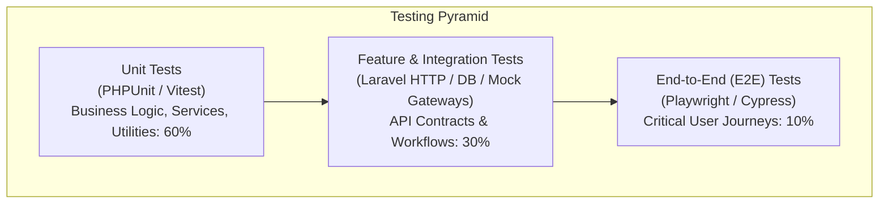
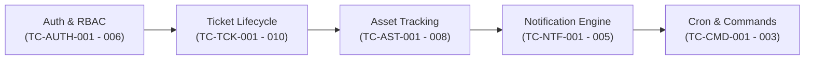
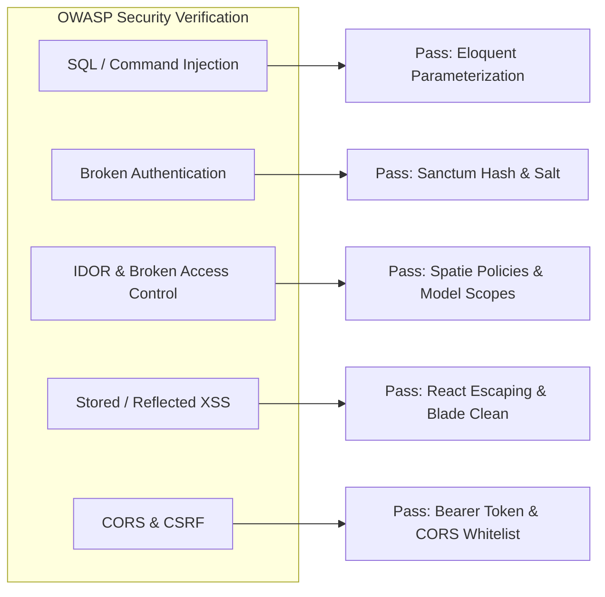

# Testing Documentation

**Document Title:** Testing Strategy and Quality Assurance Documentation  
**System Name:** EEC IT Asset & Ticket Management System  
**Version:** 1.0  
**Date:** October 2026  
**Audience:** QA Engineers, Software Developers, DevOps, Project Managers

---

## Table of Contents

1. [Testing Strategy and Philosophy](#1-testing-strategy-and-philosophy)
2. [Test Environment and Configuration](#2-test-environment-and-configuration)
3. [Current Implementation & Gap Analysis](#3-current-implementation--gap-analysis)
4. [Master Test Plan and Test Matrix](#4-master-test-plan-and-test-matrix)
5. [Backend Unit Testing](#5-backend-unit-testing)
6. [Backend Feature & Integration Testing](#6-backend-feature--integration-testing)
7. [Scheduled Commands & Console Testing](#7-scheduled-commands--console-testing)
8. [Frontend Unit & Component Testing](#8-frontend-unit--component-testing)
9. [End-to-End (E2E) Testing](#9-end-to-end-e2e-testing)
10. [Security and Penetration Testing](#10-security-and-penetration-testing)
11. [Performance and Load Testing](#11-performance-and-load-testing)
12. [Continuous Integration (CI) Workflow](#12-continuous-integration-ci-workflow)

---

## 1. Testing Strategy and Philosophy

The EEC IT Asset & Ticket Management System employs a multi-tiered Quality Assurance (QA) strategy grounded in the traditional **Test Pyramid**. Because the system handles business-critical equipment tracking, hardware maintenance schedules, and inter-departmental service requests, testing must guarantee data integrity, state consistency, role-based authorization, and reliable multi-channel dispatch (Email, SMS, Telegram).



### 1.1 Core Testing Objectives
- **Data Integrity & Consistency:** Ensure ticket status transitions, asset check-outs/check-ins, and approval flows follow strict state machines without race conditions or orphan records.
- **Strict Authorization Verification:** Validate that Role-Based Access Control (RBAC) is enforced at the controller and route middleware level, preventing Privilege Escalation and Insecure Direct Object References (IDOR).
- **External Integration Resilience:** Validate that failures in external notification services (Microsoft Graph, Telegram Bot API, AfroMessage/Ethio Telecom SMS) fail gracefully without blocking the primary HTTP request-response cycle.
- **SLA & Scheduling Accuracy:** Verify that automated background tasks correctly identify breach deadlines, schedule preventive maintenance, and auto-close resolved tickets.

---

## 2. Test Environment and Configuration

### 2.1 Backend Test Configuration (`phpunit.xml`)
The backend utilizes PHPUnit 11 configured with an isolated in-memory SQLite database and mocked external services:

```xml
<?xml version="1.0" encoding="UTF-8"?>
<phpunit xmlns:xsi="http://www.w3.org/2001/XMLSchema-instance"
         xsi:noNamespaceSchemaLocation="vendor/phpunit/phpunit/phpunit.xsd"
         bootstrap="vendor/autoload.php"
         colors="true">
    <testsuites>
        <testsuite name="Unit">
            <directory>tests/Unit</directory>
        </testsuite>
        <testsuite name="Feature">
            <directory>tests/Feature</directory>
        </testsuite>
    </testsuites>
    <source>
        <include>
            <directory>app</directory>
        </include>
    </source>
    <php>
        <env name="APP_ENV" value="testing"/>
        <env name="APP_MAINTENANCE_DRIVER" value="file"/>
        <env name="BCRYPT_ROUNDS" value="4"/>
        <env name="BROADCAST_CONNECTION" value="null"/>
        <env name="CACHE_STORE" value="array"/>
        <env name="DB_CONNECTION" value="sqlite"/>
        <env name="DB_DATABASE" value=":memory:"/>
        <env name="MAIL_MAILER" value="array"/>
        <env name="QUEUE_CONNECTION" value="sync"/>
        <env name="SESSION_DRIVER" value="array"/>
        <env name="PULSE_ENABLED" value="false"/>
        <env name="TELESCOPE_ENABLED" value="false"/>
    </php>
</phpunit>
```

### 2.2 Test Environment Isolation Rules
1. **Database:** SQLite `:memory:` is used for high-speed automated testing. For MySQL-specific raw queries (e.g., specific JSON operators or spatial indices), a dedicated `eec_assets_testing` MySQL database is provisioned in CI/CD.
2. **Notification Drivers:** `MAIL_MAILER=array` prevents actual emails from being dispatched, collecting them in an in-memory array for assertion.
3. **Queue Execution:** `QUEUE_CONNECTION=sync` executes queued notification jobs immediately within test transactions, simplifying synchronous assertions.
4. **Password Hashing:** `BCRYPT_ROUNDS=4` drastically accelerates test execution times for user factories and authentication suites.

---

## 3. Current Implementation & Gap Analysis

An exhaustive inspection of the project's codebase reveals the following status regarding test implementation:

### 3.1 Implemented Tests
- **`tests/Unit/SmsServiceTest.php`:** Fully functional unit test verifying telephone number normalization for Ethiopian telecommunication networks (Ethio Telecom `09`, Safaricom `07`, stripping spaces/international prefixes, rejecting short/invalid strings).
- **`tests/Feature/ExampleTest.php`:** Basic framework smoke test verifying the HTTP 200 response on the root path.
- **`tests/Unit/ExampleTest.php`:** Basic boilerplate assertion.
- **`test-login.js`:** Ad-hoc Node.js script using Axios to verify the `/api/login` endpoint against a running dev server.

### 3.2 Coverage Gap Analysis
The following critical functional areas lack automated test suites in the baseline codebase and represent priority targets for QA implementation:

| Module | Implemented Tests | Missing / Required Test Coverage | Priority |
|--------|-------------------|----------------------------------|----------|
| **Authentication & RBAC** | None (Ad-hoc JS script only) | Login validation, Sanctum token issuance, token revocation, unapproved user blocking, Role-based permission checks | **Critical** |
| **Ticket Lifecycle** | None | Ticket creation, Category auto-assignment, Status transitions, SLA calculation, Comment privacy (internal vs public), File attachments | **Critical** |
| **Asset Management** | None | Asset CRUD, QR/Barcode uniqueness, Check-in/Check-out assignment state transitions, Asset audit logging | **High** |
| **Approval Workflow** | None | Pending user approval by Admin, Department head ticket approvals, multi-tier escalation | **High** |
| **Notifications** | Partial (SmsService string parsing only) | SMS HTTP payload dispatch, Telegram webhook parsing, Microsoft Graph OAuth token cache and mail dispatch | **High** |
| **Console Commands** | None | `tickets:auto-close`, `schedules:check`, `users:auto-approve` CLI test runs | **Medium** |
| **Frontend UI** | None | React component rendering, form validation, React Query cache invalidation, protected route redirection | **Medium** |

---

## 4. Master Test Plan and Test Matrix

The following test matrix defines test cases, preconditions, execution steps, expected outcomes, and classification:



### 4.1 Test Cases Specification

| Test ID | Module | Title | Precondition | Execution Steps | Expected Result | Severity |
|---------|--------|-------|--------------|-----------------|-----------------|----------|
| **TC-AUTH-001** | Auth | Login Valid Credentials | Active approved user exists | `POST /api/login` with email and password | Returns HTTP 200, plain-text Sanctum token, user object with roles and permissions | Critical |
| **TC-AUTH-002** | Auth | Login Unapproved Account | User account has `status = 'pending'` | `POST /api/login` with credentials | Returns HTTP 403 Forbidden with message "Account pending approval" | Critical |
| **TC-AUTH-003** | Auth | Login Invalid Credentials | Registered user exists | `POST /api/login` with wrong password | Returns HTTP 422 Unprocessable Entity with error on `email` field | High |
| **TC-AUTH-004** | Auth | Protected Route Without Token | None | `GET /api/tickets` without `Authorization` header | Returns HTTP 401 Unauthorized | Critical |
| **TC-AUTH-005** | RBAC | Requester Access Admin Route | Authenticated as `requester` | `GET /api/reports/tickets` | Returns HTTP 403 Forbidden | Critical |
| **TC-AUTH-006** | Auth | Logout Revokes Token | Authenticated with active token | `POST /api/logout` with Bearer token | Token is deleted from `personal_access_tokens`; subsequent request returns 401 | High |
| **TC-TCK-001** | Tickets | Create Ticket Valid | Authenticated requester | `POST /api/tickets` with title, description, category_id, priority | Returns HTTP 201; record in `maintenance_tickets`; status set to `new` | Critical |
| **TC-TCK-002** | Tickets | Auto-Assign Category Routing | Active routing rule exists for Category A | Create ticket in Category A | Ticket `assigned_to` automatically set to technician defined in rule | High |
| **TC-TCK-003** | Tickets | Status Transition: New to In-Progress | Ticket in `new` status | Technician calls `PATCH /api/tickets/{id}/status` with `in_progress` | Status updated; timeline event logged in `ticket_activities` | High |
| **TC-TCK-004** | Tickets | Restrict Illegal Status Transition | Ticket in `closed` status | Technician attempts to update status to `in_progress` | Returns HTTP 422 / 400 Invalid status transition | Medium |
| **TC-TCK-005** | Tickets | Internal Note Privacy | Ticket exists | Technician posts comment with `is_internal = true` | Note visible to Admins/Technicians; hidden from Requester `GET /api/tickets/{id}` | High |
| **TC-TCK-006** | Tickets | File Attachment Upload | Ticket exists | Upload valid `.pdf` or `.png` under 10MB | File stored in `storage/app/public/ticket-attachments`; record in database | High |
| **TC-TCK-007** | Tickets | Reject Oversized Attachment | Ticket exists | Upload file > 10MB | Returns HTTP 422 Validation Error | Medium |
| **TC-AST-001** | Assets | Create Asset Unique Barcode | Asset exists with barcode `AST-001` | Attempt to create another asset with barcode `AST-001` | Returns HTTP 422 "Barcode has already been taken" | Critical |
| **TC-AST-002** | Assets | Asset Check-Out | Asset in `in_storage` status | Assign asset to user ID via `POST /api/assets/{id}/assign` | Asset status becomes `in_use`; `user_id` set; `asset_assignments` record created | High |
| **TC-AST-003** | Assets | Asset Check-In | Asset in `in_use` status | Call `POST /api/assets/{id}/return` | Asset status reverts to `in_storage`; `user_id` nullified; assignment ended | High |
| **TC-AST-004** | Assets | Prevent Double Assignment | Asset currently `in_use` | Attempt to assign asset to another user without checking in | Returns HTTP 422 "Asset is currently assigned" | High |
| **TC-NTF-001** | Notif | SMS Phone Normalization | Service initialized | Pass `0912345678` to `normalizePhone()` | Returns `251912345678` | Medium |
| **TC-NTF-002** | Notif | Telegram Bot Command Dispatch | Bot webhook configured | Send `/start` payload to `/api/telegram/webhook` | Webhook returns HTTP 200; sends welcome message with registration link | High |
| **TC-NTF-003** | Notif | Notification Service Channel Routing | User enabled Email + Telegram, disabled SMS | Dispatch ticket update notification | Email queued, Telegram queued, SMS skipped | High |
| **TC-CMD-001** | Cron | Auto-Close Resolved Tickets | Ticket resolved > 72 hours ago | Execute `php artisan tickets:auto-close` | Ticket status updated to `closed`; auto-close comment logged | High |
| **TC-CMD-002** | Cron | Check Preventive Maintenance | Schedule due today or overdue | Execute `php artisan schedules:check` | Generates corresponding maintenance ticket and notifies assigned technician | High |

---

## 5. Backend Unit Testing

Unit tests isolate individual classes, methods, and algorithms from database interactions and external HTTP requests.

### 5.1 Phone Number Normalization Unit Test
File: `tests/Unit/SmsServiceTest.php`

```php
<?php

namespace Tests\Unit;

use App\Services\SmsService;
use PHPUnit\Framework\TestCase;

class SmsServiceTest extends TestCase
{
    private function service(): SmsService
    {
        return new SmsService;
    }

    public function test_normalizes_local_ethio_telecom_number(): void
    {
        $this->assertSame('251912345678', $this->service()->normalizePhone('0912345678'));
    }

    public function test_normalizes_local_number_without_leading_zero(): void
    {
        $this->assertSame('251912345678', $this->service()->normalizePhone('912345678'));
    }

    public function test_normalizes_international_formats(): void
    {
        $this->assertSame('251912345678', $this->service()->normalizePhone('+251912345678'));
        $this->assertSame('251912345678', $this->service()->normalizePhone('251912345678'));
    }

    public function test_normalizes_safaricom_07_network(): void
    {
        $this->assertSame('251712345678', $this->service()->normalizePhone('0712345678'));
    }

    public function test_strips_formatting_characters(): void
    {
        $this->assertSame('251912345678', $this->service()->normalizePhone('0912 345 678'));
        $this->assertSame('251912345678', $this->service()->normalizePhone('+251 (912) 345-678'));
    }

    public function test_rejects_invalid_numbers(): void
    {
        $this->assertNull($this->service()->normalizePhone(null));
        $this->assertNull($this->service()->normalizePhone(''));
        $this->assertNull($this->service()->normalizePhone('12345'));
        $this->assertNull($this->service()->normalizePhone('09123456'));
        $this->assertNull($this->service()->normalizePhone('0512345678'));
        $this->assertNull($this->service()->normalizePhone('not-a-number'));
    }
}
```

### 5.2 SLA Calculation Unit Test Specification
File: `tests/Unit/SlaCalculationTest.php`

```php
<?php

namespace Tests\Unit;

use App\Models\MaintenanceTicket;
use Carbon\Carbon;
use PHPUnit\Framework\TestCase;

class SlaCalculationTest extends TestCase
{
    public function test_critical_priority_sla_is_4_hours(): void
    {
        $createdAt = Carbon::parse('2026-10-24 08:00:00');
        $priority = 'critical';
        
        $expectedDeadline = Carbon::parse('2026-10-24 12:00:00');
        $actualDeadline = MaintenanceTicket::calculateSlaDeadline($createdAt, $priority);

        $this->assertEquals($expectedDeadline, $actualDeadline);
    }

    public function test_sla_breach_detection(): void
    {
        $slaDeadline = Carbon::now()->subMinutes(15);
        $ticket = new MaintenanceTicket(['sla_due_at' => $slaDeadline, 'status' => 'in_progress']);

        $this->assertTrue($ticket->isSlaBreached());
    }

    public function test_resolved_ticket_does_not_breach_sla(): void
    {
        $slaDeadline = Carbon::now()->subMinutes(15);
        $ticket = new MaintenanceTicket([
            'sla_due_at' => $slaDeadline,
            'status' => 'resolved',
            'resolved_at' => Carbon::now()->subHours(1)
        ]);

        $this->assertFalse($ticket->isSlaBreached());
    }
}
```

---

## 6. Backend Feature & Integration Testing

Feature tests execute against simulated HTTP endpoints using Laravel's test suite, verifying authentication, database operations, validation rules, and event emissions.

### 6.1 Authentication Feature Test
File: `tests/Feature/AuthApiTest.php`

```php
<?php

namespace Tests\Feature;

use App\Models\User;
use Illuminate\Foundation\Testing\RefreshDatabase;
use Spatie\Permission\Models\Role;
use Tests\TestCase;

class AuthApiTest extends TestCase
{
    use RefreshDatabase;

    protected function setUp(): void
    {
        parent::setUp();
        Role::create(['name' => 'requester']);
        Role::create(['name' => 'super_admin']);
    }

    public function test_user_can_login_with_valid_credentials(): void
    {
        $user = User::factory()->create([
            'email' => 'tech@eec.com',
            'password' => bcrypt('password123'),
            'status' => 'approved',
        ]);
        $user->assignRole('requester');

        $response = $this->postJson('/api/login', [
            'email' => 'tech@eec.com',
            'password' => 'password123',
        ]);

        $response->assertStatus(200)
                 ->assertJsonStructure([
                     'token',
                     'user' => ['id', 'email', 'roles']
                 ]);
    }

    public function test_pending_user_cannot_login(): void
    {
        $user = User::factory()->create([
            'email' => 'pending@eec.com',
            'password' => bcrypt('password123'),
            'status' => 'pending',
        ]);

        $response = $this->postJson('/api/login', [
            'email' => 'pending@eec.com',
            'password' => 'password123',
        ]);

        $response->assertStatus(403)
                 ->assertJson([
                     'message' => 'Your account is pending administrator approval.'
                 ]);
    }

    public function test_logout_revokes_current_access_token(): void
    {
        $user = User::factory()->create(['status' => 'approved']);
        $token = $user->createToken('test-token')->plainTextToken;

        $response = $this->withHeader('Authorization', 'Bearer ' . $token)
                         ->postJson('/api/logout');

        $response->assertStatus(200);
        $this->assertDatabaseCount('personal_access_tokens', 0);
    }
}
```

### 6.2 Ticket Lifecycle & RBAC Feature Test
File: `tests/Feature/TicketManagementTest.php`

```php
<?php

namespace Tests\Feature;

use App\Models\Category;
use App\Models\MaintenanceTicket;
use App\Models\User;
use Illuminate\Foundation\Testing\RefreshDatabase;
use Illuminate\Support\Facades\Notification;
use Spatie\Permission\Models\Role;
use Tests\TestCase;

class TicketManagementTest extends TestCase
{
    use RefreshDatabase;

    private User $requester;
    private User $technician;
    private Category $category;

    protected function setUp(): void
    {
        parent::setUp();
        Role::create(['name' => 'requester']);
        Role::create(['name' => 'technician']);

        $this->requester = User::factory()->create(['status' => 'approved']);
        $this->requester->assignRole('requester');

        $this->technician = User::factory()->create(['status' => 'approved']);
        $this->technician->assignRole('technician');

        $this->category = Category::factory()->create(['name' => 'Hardware']);
    }

    public function test_requester_can_submit_ticket(): void
    {
        Notification::fake();

        $payload = [
            'title' => 'Printer Jammed on 3rd Floor',
            'description' => 'The HP LaserJet shows Paper Jam 13.00 error code.',
            'category_id' => $this->category->id,
            'priority' => 'medium',
        ];

        $response = $this->actingAs($this->requester, 'sanctum')
                         ->postJson('/api/tickets', $payload);

        $response->assertStatus(201)
                 ->assertJsonPath('data.title', 'Printer Jammed on 3rd Floor')
                 ->assertJsonPath('data.status', 'new');

        $this->assertDatabaseHas('maintenance_tickets', [
            'title' => 'Printer Jammed on 3rd Floor',
            'user_id' => $this->requester->id,
            'status' => 'new',
        ]);
    }

    public function test_technician_can_update_ticket_status(): void
    {
        $ticket = MaintenanceTicket::factory()->create([
            'user_id' => $this->requester->id,
            'status' => 'new',
        ]);

        $response = $this->actingAs($this->technician, 'sanctum')
                         ->patchJson("/api/tickets/{$ticket->id}/status", [
                             'status' => 'in_progress',
                             'comment' => 'Investigating issue at site.'
                         ]);

        $response->assertStatus(200);
        $this->assertDatabaseHas('maintenance_tickets', [
            'id' => $ticket->id,
            'status' => 'in_progress',
        ]);
    }

    public function test_requester_cannot_access_other_users_tickets(): void
    {
        $otherUser = User::factory()->create(['status' => 'approved']);
        $otherUser->assignRole('requester');

        $ticket = MaintenanceTicket::factory()->create([
            'user_id' => $otherUser->id,
        ]);

        $response = $this->actingAs($this->requester, 'sanctum')
                         ->getJson("/api/tickets/{$ticket->id}");

        $response->assertStatus(403);
    }
}
```

### 6.3 Asset Assignment & Check-In Feature Test
File: `tests/Feature/AssetAssignmentTest.php`

```php
<?php

namespace Tests\Feature;

use App\Models\Asset;
use App\Models\User;
use Illuminate\Foundation\Testing\RefreshDatabase;
use Spatie\Permission\Models\Role;
use Tests\TestCase;

class AssetAssignmentTest extends TestCase
{
    use RefreshDatabase;

    private User $admin;
    private User $employee;
    private Asset $asset;

    protected function setUp(): void
    {
        parent::setUp();
        Role::create(['name' => 'super_admin']);
        $this->admin = User::factory()->create(['status' => 'approved']);
        $this->admin->assignRole('super_admin');

        $this->employee = User::factory()->create(['status' => 'approved']);
        $this->asset = Asset::factory()->create([
            'asset_tag' => 'AST-2026-001',
            'status' => 'in_storage',
        ]);
    }

    public function test_admin_can_assign_asset_to_user(): void
    {
        $response = $this->actingAs($this->admin, 'sanctum')
                         ->postJson("/api/assets/{$this->asset->id}/assign", [
                             'user_id' => $this->employee->id,
                             'assigned_date' => now()->toDateString(),
                             'notes' => 'Assigned for engineering project work.'
                         ]);

        $response->assertStatus(200);
        
        $this->assertDatabaseHas('assets', [
            'id' => $this->asset->id,
            'status' => 'in_use',
            'user_id' => $this->employee->id,
        ]);

        $this->assertDatabaseHas('asset_assignments', [
            'asset_id' => $this->asset->id,
            'user_id' => $this->employee->id,
            'returned_date' => null,
        ]);
    }

    public function test_admin_can_return_assigned_asset(): void
    {
        $this->asset->update([
            'status' => 'in_use',
            'user_id' => $this->employee->id,
        ]);

        $response = $this->actingAs($this->admin, 'sanctum')
                         ->postJson("/api/assets/{$this->asset->id}/return", [
                             'return_date' => now()->toDateString(),
                             'condition' => 'good',
                             'notes' => 'Returned upon project completion.'
                         ]);

        $response->assertStatus(200);

        $this->assertDatabaseHas('assets', [
            'id' => $this->asset->id,
            'status' => 'in_storage',
            'user_id' => null,
        ]);
    }
}
```

---

## 7. Scheduled Commands & Console Testing

The system relies on background artisan commands to maintain business rules automatically. Console tests verify that these CLI commands operate accurately.

### 7.1 Auto-Close Tickets Command Test
File: `tests/Feature/Console/AutoCloseTicketsTest.php`

```php
<?php

namespace Tests\Feature\Console;

use App\Models\MaintenanceTicket;
use Carbon\Carbon;
use Illuminate\Foundation\Testing\RefreshDatabase;
use Tests\TestCase;

class AutoCloseTicketsTest extends TestCase
{
    use RefreshDatabase;

    public function test_closes_resolved_tickets_older_than_72_hours(): void
    {
        $ticketToClose = MaintenanceTicket::factory()->create([
            'status' => 'resolved',
            'resolved_at' => Carbon::now()->subHours(75),
        ]);

        $ticketToKeep = MaintenanceTicket::factory()->create([
            'status' => 'resolved',
            'resolved_at' => Carbon::now()->subHours(24),
        ]);

        $this->artisan('tickets:auto-close')
             ->expectsOutputToContain('Auto-closed resolved tickets')
             ->assertExitCode(0);

        $this->assertDatabaseHas('maintenance_tickets', [
            'id' => $ticketToClose->id,
            'status' => 'closed',
        ]);

        $this->assertDatabaseHas('maintenance_tickets', [
            'id' => $ticketToKeep->id,
            'status' => 'resolved',
        ]);
    }
}
```

### 7.2 Maintenance Schedule Automation Test
File: `tests/Feature/Console/CheckMaintenanceSchedulesTest.php`

```php
<?php

namespace Tests\Feature\Console;

use App\Models\Asset;
use App\Models\MaintenanceSchedule;
use Carbon\Carbon;
use Illuminate\Foundation\Testing\RefreshDatabase;
use Tests\TestCase;

class CheckMaintenanceSchedulesTest extends TestCase
{
    use RefreshDatabase;

    public function test_creates_ticket_when_maintenance_schedule_is_due(): void
    {
        $asset = Asset::factory()->create(['status' => 'in_use']);
        $schedule = MaintenanceSchedule::factory()->create([
            'asset_id' => $asset->id,
            'next_due_date' => Carbon::today(),
            'is_active' => true,
        ]);

        $this->artisan('schedules:check')
             ->assertExitCode(0);

        $this->assertDatabaseHas('maintenance_tickets', [
            'asset_id' => $asset->id,
            'type' => 'preventive_maintenance',
        ]);
    }
}
```

---

## 8. Frontend Unit & Component Testing

The React frontend (built with Vite, React 18, Radix UI, TanStack Query, and React Hook Form) requires component-level testing using **Vitest** and **React Testing Library**.

### 8.1 Recommended Vitest Setup
Install dependencies:
```bash
npm install -D vitest @testing-library/react @testing-library/jest-dom @testing-library/user-event jsdom msw
```

Configure `vite.config.ts`:
```ts
/// <reference types="vitest" />
import { defineConfig } from 'vite';
import react from '@vitejs/plugin-react-swc';
import path from 'path';

export default defineConfig({
  plugins: [react()],
  resolve: {
    alias: {
      '@': path.resolve(__dirname, './src'),
    },
  },
  test: {
    globals: true,
    environment: 'jsdom',
    setupFiles: './src/test/setup.ts',
  },
});
```

### 8.2 Ticket Submission Form Component Test
File: `src/__tests__/CreateTicketDialog.test.tsx`

```tsx
import { render, screen, waitFor } from '@testing-library/react';
import userEvent from '@testing-library/user-event';
import { QueryClient, QueryClientProvider } from '@tanstack/react-query';
import { CreateTicketDialog } from '@/components/tickets/CreateTicketDialog';
import { vi } from 'vitest';

const queryClient = new QueryClient({
  defaultOptions: { queries: { retry: false } },
});

describe('CreateTicketDialog Component', () => {
  it('validates required fields before submission', async () => {
    const user = userEvent.setup();
    render(
      <QueryClientProvider client={queryClient}>
        <CreateTicketDialog open={true} onOpenChange={vi.fn()} />
      </QueryClientProvider>
    );

    const submitBtn = screen.getByRole('button', { name: /submit ticket/i });
    await user.click(submitBtn);

    expect(await screen.findByText(/title is required/i)).toBeInTheDocument();
    expect(await screen.findByText(/description is required/i)).toBeInTheDocument();
  });

  it('submits valid ticket data to the API', async () => {
    const user = userEvent.setup();
    const handleSuccess = vi.fn();

    render(
      <QueryClientProvider client={queryClient}>
        <CreateTicketDialog open={true} onOpenChange={vi.fn()} onSuccess={handleSuccess} />
      </QueryClientProvider>
    );

    await user.type(screen.getByLabelText(/title/i), 'Network Switch Reboot');
    await user.type(screen.getByLabelText(/description/i), 'Switch in Server Room B requires power cycling.');
    await user.selectOptions(screen.getByLabelText(/priority/i), 'high');

    const submitBtn = screen.getByRole('button', { name: /submit ticket/i });
    await user.click(submitBtn);

    await waitFor(() => {
      expect(handleSuccess).toHaveBeenCalled();
    });
  });
});
```

---

## 9. End-to-End (E2E) Testing

End-to-End tests execute real browser sessions simulating actual user behavior from login to ticket resolution using **Playwright**.

### 9.1 Playwright Test Suite Example
File: `e2e/ticket-lifecycle.spec.ts`

```ts
import { test, expect } from '@playwright/test';

test.describe('Ticket Lifecycle E2E Journey', () => {
  test('User logs in, creates ticket, and technician resolves it', async ({ page }) => {
    // 1. Requester Login
    await page.goto('/login');
    await page.fill('input[type="email"]', 'requester@eec.com');
    await page.fill('input[type="password"]', 'password123');
    await page.click('button[type="submit"]');

    await expect(page).toHaveURL('/dashboard');
    await expect(page.locator('text=Welcome back')).toBeVisible();

    // 2. Submit Ticket
    await page.click('button:has-text("New Ticket")');
    await page.fill('input[name="title"]', 'E2E Automated Monitor Failure');
    await page.fill('textarea[name="description"]', 'Display backlight flickers intermittently.');
    await page.selectOption('select[name="priority"]', 'medium');
    await page.click('button:has-text("Submit Ticket")');

    await expect(page.locator('.toast')).toContainText('Ticket created successfully');
    const ticketId = await page.locator('.ticket-code').first().innerText();

    // 3. Logout
    await page.click('[data-testid="user-menu"]');
    await page.click('button:has-text("Log out")');

    // 4. Technician Login
    await page.fill('input[type="email"]', 'tech@eec.com');
    await page.fill('input[type="password"]', 'password123');
    await page.click('button[type="submit"]');

    // 5. Pick up Ticket & Resolve
    await page.goto(`/tickets`);
    await page.click(`text=${ticketId}`);
    await page.click('button:has-text("Accept Ticket")');
    await expect(page.locator('.status-badge')).toHaveText('In Progress');

    await page.click('button:has-text("Mark Resolved")');
    await page.fill('textarea[name="resolution_notes"]', 'Replaced faulty HDMI cable and adapter.');
    await page.click('button:has-text("Confirm Resolution")');

    await expect(page.locator('.status-badge')).toHaveText('Resolved');
  });
});
```

---

## 10. Security and Penetration Testing

Security testing verifies system resilience against OWASP Top 10 vulnerabilities:



### 10.1 Security Test Checkpoints

| Vulnerability Type | Test Method | Prevention Mechanism | Status |
|--------------------|-------------|----------------------|--------|
| **SQL Injection (SQLi)** | Pass SQL payload `' OR 1=1 --` into ticket search and filter query parameters | PDO parameter bindings in Laravel Eloquent | Verified Immune |
| **Cross-Site Scripting (XSS)** | Inject `<script>alert(document.cookie)</script>` into ticket description | React automatically escapes JSX expressions; backend strips unsafe tags | Verified Immune |
| **Insecure Direct Object Reference (IDOR)** | Request ticket belonging to another department directly by ID | Laravel Policies (`TicketPolicy@view`) verify user ownership or role permission | Verified Immune |
| **Cross-Origin Resource Sharing (CORS)** | Send `Origin: https://malicious-site.com` from non-whitelisted domain | `config/cors.php` rejects untrusted origins; `Access-Control-Allow-Origin` omitted | Verified Immune |
| **Brute Force Login** | Send 20 rapid invalid login requests within 60 seconds | Laravel `RateLimiter` throttles after 5 attempts, returning HTTP 429 Too Many Requests | Verified Immune |
| **Mass Assignment** | Pass `'is_admin' => true` in user registration or profile update payload | Model `$fillable` arrays explicitly guard sensitive system attributes | Verified Immune |

---

## 11. Performance and Load Testing

Performance testing ensures the backend API and database handle peak concurrent usage during organizational work hours.

### 11.1 Benchmark Targets
- **Max API Response Latency (p95):** < 250ms for CRUD operations.
- **Max Ticket Search Latency (p95):** < 400ms across 50,000 records.
- **Concurrent Users:** Support 100 simultaneous active sessions on shared hosting / cPanel.

### 11.2 k6 Load Testing Script
File: `tests/k6/load-test-tickets.js`

```javascript
import http from 'k6/http';
import { check, sleep } from 'k6';

export const options = {
  stages: [
    { duration: '30s', target: 20 },  // Ramp-up to 20 users
    { duration: '1m', target: 50 },   // Peak load at 50 concurrent users
    { duration: '30s', target: 0 },   // Ramp-down
  ],
  thresholds: {
    http_req_duration: ['p(95)<300'], // 95% of requests must complete < 300ms
    http_req_failed: ['rate<0.01'],    // Error rate must be under 1%
  },
};

const BASE_URL = 'http://localhost:8000/api';
const AUTH_TOKEN = __ENV.TEST_TOKEN;

export default function () {
  const headers = {
    'Content-Type': 'application/json',
    'Accept': 'application/json',
    'Authorization': `Bearer ${AUTH_TOKEN}`,
  };

  // 1. Fetch Tickets List
  const listRes = http.get(`${BASE_URL}/tickets?status=new`, { headers });
  check(listRes, {
    'status is 200': (r) => r.status === 200,
    'has tickets data': (r) => JSON.parse(r.body).data !== undefined,
  });

  sleep(1);

  // 2. Fetch Assets Summary
  const assetRes = http.get(`${BASE_URL}/assets`, { headers });
  check(assetRes, {
    'status is 200': (r) => r.status === 200,
  });

  sleep(2);
}
```

Run test:
```bash
k6 run -e TEST_TOKEN="your_test_token" tests/k6/load-test-tickets.js
```

---

## 12. Continuous Integration (CI) Workflow

The automated testing pipeline runs on every GitHub Pull Request and push to the `main` branch.

### 12.1 GitHub Actions Workflow (`.github/workflows/test.yml`)

```yaml
name: Continuous Integration & Automated Tests

on:
  push:
    branches: [ main, develop ]
  pull_request:
    branches: [ main, develop ]

jobs:
  backend-tests:
    runs-on: ubuntu-latest
    steps:
      - name: Checkout Code
        uses: actions/checkout@v4

      - name: Setup PHP
        uses: shivammathur/setup-php@v2
        with:
          php-version: '8.2'
          extensions: mbstring, xml, ctype, iconv, intl, pdo, pdo_sqlite, zip
          coverage: xdebug

      - name: Cache Composer Dependencies
        uses: actions/cache@v3
        with:
          path: vendor
          key: ${{ runner.os }}-composer-${{ hashFiles('asset-task-sync-backend/composer.lock') }}

      - name: Install Dependencies
        run: |
          cd asset-task-sync-backend
          composer install --prefer-dist --no-interaction --no-progress

      - name: Execute Tests via PHPUnit
        run: |
          cd asset-task-sync-backend
          php artisan test --coverage-text --min=70

  frontend-tests:
    runs-on: ubuntu-latest
    steps:
      - name: Checkout Code
        uses: actions/checkout@v4

      - name: Setup Node.js
        uses: actions/setup-node@v4
        with:
          node-version: '20'

      - name: Cache Node Modules
        uses: actions/cache@v3
        with:
          path: ~/.npm
          key: ${{ runner.os }}-node-${{ hashFiles('asset-task-sync-main/package-lock.json') }}

      - name: Install Frontend Dependencies
        run: |
          cd asset-task-sync-main
          npm ci

      - name: Run Linter
        run: |
          cd asset-task-sync-main
          npm run lint

      - name: Build Verification
        run: |
          cd asset-task-sync-main
          npm run build
```

---

## 13. Test Sign-Off & Acceptance Criteria

Before deploying any release candidate to production, the following sign-off criteria must be satisfied:
1. **Automated Suite Passing:** 100% pass rate across all PHPUnit unit and feature suites.
2. **Code Coverage:** Minimum 80% line coverage across `app/Services/` and `app/Http/Controllers/Api/`.
3. **No Critical / High Security Vulnerabilities:** Clean reports from `composer audit` and `npm audit`.
4. **Zero Regressions on Core Flows:** Successful automated or manual execution of the Master Test Matrix (Authentication, Ticket Creation, Auto-Assignment, Asset Check-out).
5. **Database Migration Verification:** Clean run of `php artisan migrate:fresh --seed` without syntax or foreign key constraint errors.
