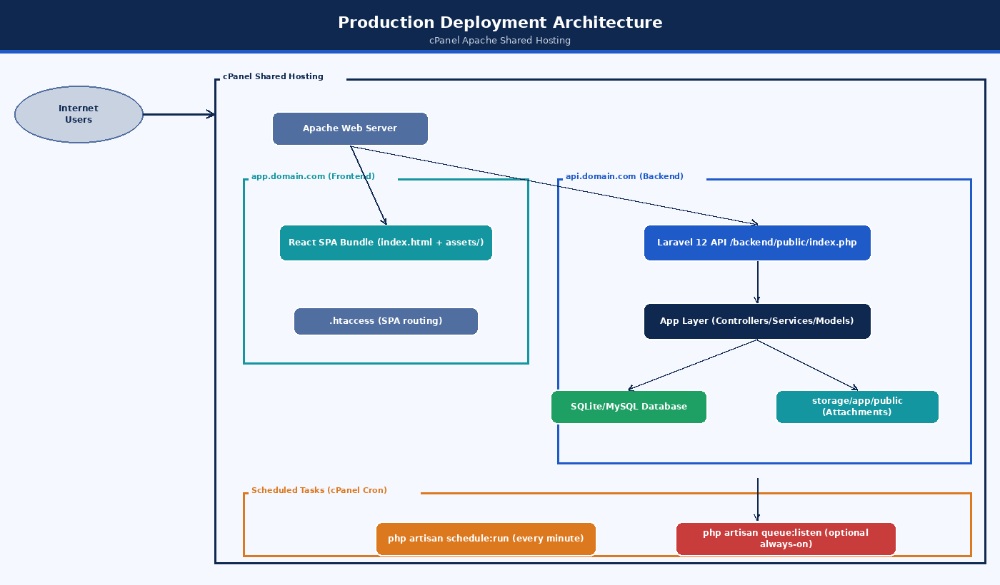
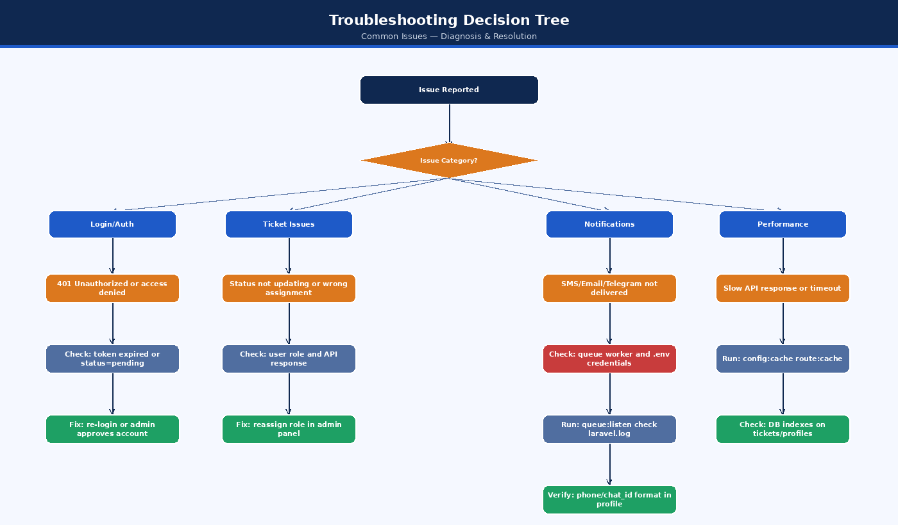
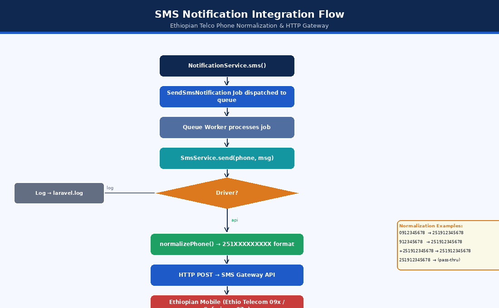
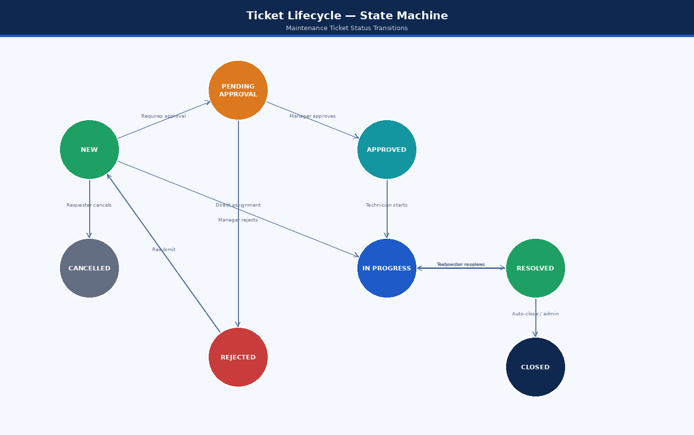
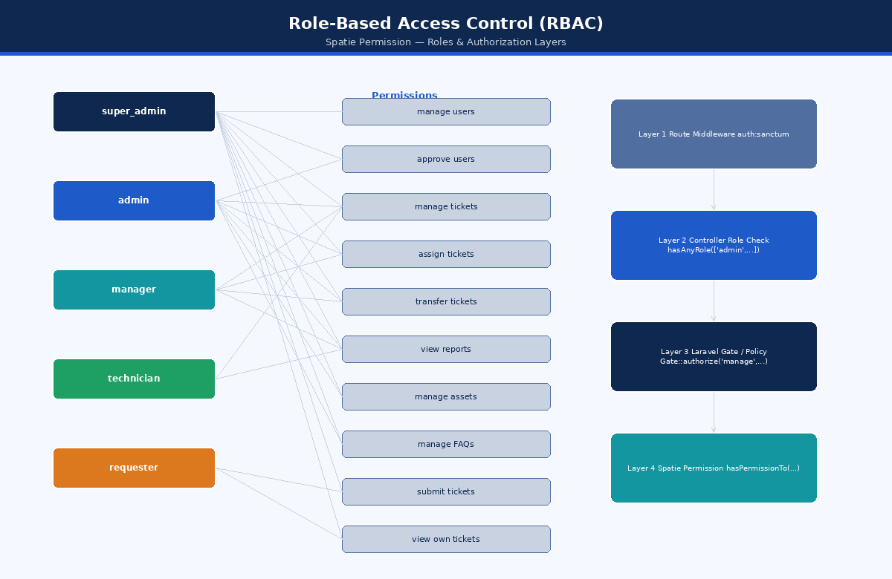

# 08 — Maintenance and Troubleshooting

**Document:** Technical Documentation  
**System:** EEC IT Asset & Ticket Management System  
**Version:** 1.0  
**Date:** October 2026  
**Audience:** System administrators, DevOps, technical support

---

## Table of Contents

1. [Operational Overview and Service Architecture](#1-operational-overview-and-service-architecture)
2. [Routine Maintenance Schedules and Checklists](#2-routine-maintenance-schedules-and-checklists)
3. [Logging, Monitoring, and Auditing](#3-logging-monitoring-and-auditing)
4. [Database Maintenance, Backup, and Optimization](#4-database-maintenance-backup-and-optimization)
5. [Queue Worker and Background Task Administration](#5-queue-worker-and-background-task-administration)
6. [Storage, File System, and Attachment Management](#6-storage-file-system-and-attachment-management)
7. [Cache Management and Performance Tuning](#7-cache-management-and-performance-tuning)
8. [Third-Party Integration Maintenance](#8-third-party-integration-maintenance)
9. [Security Patching and Dependency Upgrades](#9-security-patching-and-dependency-upgrades)
10. [Disaster Recovery and Business Continuity](#10-disaster-recovery-and-business-continuity)
11. [Comprehensive Troubleshooting Runbooks](#11-comprehensive-troubleshooting-runbooks)

---

## 1. Operational Overview and Service Architecture

The EEC IT Asset & Ticket Management System is deployed as a decoupled system: a Single Page Application (SPA) built with React and a RESTful backend API powered by Laravel 12 on PHP 8.2+. The operational architecture relies on automated cron scheduling, asynchronous queue processing, MySQL relational storage, and multi-channel notification gateways.



*Figure: Production Deployment Architecture*

### 1.1 Support Responsibilities & Escalation Flow
Operational incidents must be triaged according to severity levels:



*Figure: Troubleshooting Decision Tree*

---

## 2. Routine Maintenance Schedules and Checklists

Maintaining system health requires regular inspections across server resources, database indexes, background queues, and storage partitions.

### 2.1 Daily Maintenance Checklist
- [ ] **Queue Worker Health:** Verify that `queue:work` is actively running without stale or blocked processes.
- [ ] **Failed Jobs Inspection:** Check the `failed_jobs` table for unhandled exceptions (`php artisan queue:failed`).
- [ ] **Error Log Review:** Inspect `storage/logs/laravel.log` for recurring HTTP 500 exceptions or third-party timeout warnings.
- [ ] **Disk Usage Inspection:** Ensure root and `/home` partitions remain under 80% capacity (`df -h`).
- [ ] **Database Backup Verification:** Confirm that the daily automated `mysqldump` snapshot completed successfully.

### 2.2 Weekly Maintenance Checklist
- [ ] **Prune Expired Access Tokens:** Purge revoked and expired tokens from `personal_access_tokens` to prevent table bloat:
  ```bash
  php artisan sanctum:prune-expired --hours=48
  ```
- [ ] **Clean Temporary Export Files:** Delete cached CSV, XLSX, and PDF exports older than 7 days from `storage/app/temp/`.
- [ ] **SMS Gateway Credit Balance:** Verify remaining balance on AfroMessage / Ethio Telecom SMS gateway account.
- [ ] **Review Audit Logs:** Check `activity_log` for repeated failed login attempts or unusual admin permission changes.

### 2.3 Monthly Maintenance Checklist
- [ ] **Database Index Optimization:** Run `OPTIMIZE TABLE` on high-churn tables (`maintenance_tickets`, `ticket_activities`, `activity_log`).
- [ ] **Dependency Security Audit:** Scan PHP and JavaScript packages for known Common Vulnerabilities and Exposures (CVEs):
  ```bash
  composer audit
  npm audit --prefix ../asset-task-sync-main
  ```
- [ ] **SSL / TLS Certificate Inspection:** Verify expiration date of server SSL certificates (Let's Encrypt / Sectigo).
- [ ] **Storage Quota & Attachment Cleanup:** Audit disk space consumed by `storage/app/public/ticket-attachments/`.

### 2.4 Quarterly Maintenance Checklist
- [ ] **Disaster Recovery Drill:** Perform a full restore from offsite backup to an isolated staging environment.
- [ ] **Third-Party API Secret Rotation:** Rotate Microsoft Graph client secrets, Telegram Bot tokens, and SMS gateway API keys.
- [ ] **PHP and Web Server Security Updates:** Update PHP minor versions (e.g., 8.2.x to latest patch) and Linux packages (`apt update && apt upgrade` or cPanel EasyApache update).

---

## 3. Logging, Monitoring, and Auditing

The system maintains several distinct log channels essential for operational diagnostics and regulatory compliance.


*Figure: Infrastructure Architecture*

### 3.1 Laravel Log Configuration
The logging pipeline is configured via `config/logging.php`. In production, the `daily` log driver should be active to ensure automatic log rotation:

```env
LOG_CHANNEL=daily
LOG_DEPRECATIONS_CHANNEL=null
LOG_LEVEL=info
```

#### Log Rotation Policy (`logrotate`)
When operating on dedicated virtual machines or standard Linux VPS environments, configure `/etc/logrotate.d/asset-task-sync`:
```conf
/home/user/asset-task-sync-backend/storage/logs/*.log {
    su user user
    daily
    missingok
    rotate 14
    compress
    delaycompress
    notifempty
    create 0664 user user
}
```

### 3.2 System Activity & Audit Trail (`ActivityLogger`)
Administrative actions, role modifications, and ticket status changes are tracked via the `ActivityLogger` service into the `activity_log` database table:
- **Recorded Attributes:** `causer_id` (User ID), `event` (created, updated, deleted, status_changed), `subject_type` (Model), `subject_id`, `properties` (JSON diff of old vs new values), `ip_address`, `user_agent`.
- **Querying Audit Logs via Artisan Tinker:**
  ```bash
  php artisan tinker
  >>> \App\Models\ActivityLog::where('subject_type', 'App\Models\MaintenanceTicket')->latest()->take(5)->get();
  ```

---

## 4. Database Maintenance, Backup, and Optimization

MySQL 8.0 serves as the primary data store. Maintaining database speed and zero data loss requires consistent maintenance practices.

### 4.1 Automated Daily Backup Procedure
A daily backup script captures the entire database with transactional consistency:

```bash
#!/bin/bash
# /home/user/scripts/backup_db.sh

BACKUP_DIR="/home/user/backups/database"
DATE=$(date +"%Y%m%d_%H%M%S")
DB_NAME="eec_asset_sync"
DB_USER="eec_db_user"
DB_PASS="YOUR_SECURE_PASSWORD"
RETAIN_DAYS=30

mkdir -p "$BACKUP_DIR"

# Perform mysqldump with single transaction for InnoDB tables
mysqldump -u "$DB_USER" -p"$DB_PASS" \
  --single-transaction \
  --quick \
  --routines \
  --triggers \
  "$DB_NAME" | gzip > "$BACKUP_DIR/${DB_NAME}_backup_${DATE}.sql.gz"

# Enforce retention policy: delete archives older than 30 days
find "$BACKUP_DIR" -type f -name "*.sql.gz" -mtime +$RETAIN_DAYS -delete

echo "Database backup completed successfully: ${DB_NAME}_backup_${DATE}.sql.gz"
```

Configure via crontab:
```cron
0 2 * * * /bin/bash /home/user/scripts/backup_db.sh >> /home/user/backups/backup.log 2>&1
```

### 4.2 Database Restoration Procedure
In the event of database corruption or hardware failure:

1. **Stop Queue Workers & Maintenance Mode:**
   ```bash
   php artisan down --message="Database maintenance in progress. Please check back shortly."
   ```

2. **Decompress and Restore Backup:**
   ```bash
   gunzip < /home/user/backups/database/eec_asset_sync_backup_YYYYMMDD_HHMMSS.sql.gz | mysql -u eec_db_user -p eec_asset_sync
   ```

3. **Execute Any Pending Migrations:**
   ```bash
   php artisan migrate --force
   ```

4. **Clear Application Cache & Bring Online:**
   ```bash
   php artisan optimize:clear
   php artisan optimize
   php artisan up
   ```

### 4.3 Database Optimization Queries
Execute monthly to reclaim disk space and rebuild B-tree index statistics:

```sql
-- Optimize high-volume tables
OPTIMIZE TABLE maintenance_tickets;
OPTIMIZE TABLE ticket_activities;
OPTIMIZE TABLE ticket_comments;
OPTIMIZE TABLE activity_log;
OPTIMIZE TABLE notifications;
OPTIMIZE TABLE personal_access_tokens;

-- Check table fragmentation
SELECT table_name, data_length, index_length, data_free 
FROM information_schema.tables 
WHERE table_schema = 'eec_asset_sync' AND data_free > 0;
```

---

## 5. Queue Worker and Background Task Administration

Asynchronous tasks (email dispatches via Microsoft Graph, SMS delivery, Telegram webhooks, SLA breach checks) are handled by the Laravel queue worker.


*Figure: Notification Service Flow*

### 5.1 Supervisord Configuration
In environments supporting daemon supervisors, configure `/etc/supervisor/conf.d/asset-sync-worker.conf`:

```ini
[program:asset-sync-worker]
process_name=%(program_name)s_%(process_num)02d
command=php /home/user/public_html/api/artisan queue:work --sleep=3 --tries=3 --max-time=3600 --timeout=90
autostart=true
autorestart=true
user=user
numprocs=2
redirect_stderr=true
stdout_logfile=/home/user/asset-task-sync-backend/storage/logs/worker.log
stopwaitsecs=3600
```

### 5.2 Managing Failed Jobs
When an external API times out or credentials fail, jobs land in the `failed_jobs` table:

```bash
# List all failed jobs
php artisan queue:failed

# Retry a specific failed job by UUID
php artisan queue:retry <UUID>

# Retry all failed jobs
php artisan queue:retry all

# Purge all failed jobs after investigation
php artisan queue:flush
```

---

## 6. Storage, File System, and Attachment Management

Ticket attachments (images, PDF schematics, diagnostic logs) are stored under `storage/app/public/ticket-attachments/`.

### 6.1 Storage Symlink Integrity
The public web directory requires a symbolic link pointing to storage:
```bash
# Verify symbolic link
ls -la public/storage

# Recreate if broken or missing
php artisan storage:link
```

### 6.2 Cleaning Orphaned Attachments
If a ticket creation fails or attachments are deleted without cascading:

```php
// Run via php artisan tinker to detect orphaned files
$registeredFiles = \App\Models\TicketAttachment::pluck('file_path')->toArray();
$diskFiles = \Illuminate\Support\Facades\Storage::disk('public')->files('ticket-attachments');

$orphaned = array_diff($diskFiles, $registeredFiles);
foreach ($orphaned as $file) {
    \Illuminate\Support\Facades\Storage::disk('public')->delete($file);
}
```

---

## 7. Cache Management and Performance Tuning

Laravel compiles configuration, routes, and views into cached files for maximum throughput.

### 7.1 Production Optimization Command Sequence
Execute this sequence after any configuration change, route modification, or code deployment:

```bash
# 1. Clear all existing caches
php artisan optimize:clear

# 2. Recompile configurations into a single file
php artisan config:cache

# 3. Compile routes into a high-speed lookup tree
php artisan route:cache

# 4. Cache compiled Blade templates (if utilized)
php artisan view:cache

# 5. Cache events and listeners
php artisan event:cache
```

### 7.2 OPcache Recommended Configuration
Ensure PHP OPcache is enabled in `php.ini` on the production server:
```ini
zend_extension=opcache
opcache.enable=1
opcache.enable_cli=0
opcache.memory_consumption=128
opcache.interned_strings_buffer=16
opcache.max_accelerated_files=10000
opcache.revalidate_freq=0
opcache.validate_timestamps=0
opcache.save_comments=1
```
*(Note: If `validate_timestamps=0`, OPcache must be restarted or reloaded via `systemctl reload php8.2-fpm` whenever code is updated).*

---

## 8. Third-Party Integration Maintenance

The system interfaces with three external communication providers. Periodic maintenance ensures unhindered delivery.



*Figure: SMS Integration Troubleshooting*

### 8.1 Microsoft Graph Integration
- **OAuth Secret Lifecycle:** Azure AD application client secrets expire after 1 to 2 years.
- **Rotation Procedure:**
  1. Navigate to **Azure Portal** > **App Registrations** > **EEC IT Asset Sync**.
  2. Under **Certificates & Secrets**, generate a new Client Secret.
  3. Update `MICROSOFT_GRAPH_CLIENT_SECRET` in `.env`.
  4. Run `php artisan config:cache`.
  5. Test email dispatch using `php artisan test:email user@eec.com`.

### 8.2 SMS Gateway (Ethio Telecom / AfroMessage)
- **Credit Balance Threshold:** Set a calendar reminder to replenish gateway credits when balance drops below 500 messages.
- **Endpoint Health:** Test connectivity using the built-in console test command:
  ```bash
  php artisan test:sms 0912345678 "EEC System Test Message"
  ```

### 8.3 Telegram Bot API
- **Webhook Status Verification:** Check webhook delivery metrics directly against Telegram's API:
  ```bash
  curl -s "https://api.telegram.org/bot<YOUR_TELEGRAM_BOT_TOKEN>/getWebhookInfo"
  ```
- **Resetting Webhook:** If the webhook encounters SSL errors or drops connections:
  ```bash
  curl -F "url=https://api.yourdomain.com/api/telegram/webhook" \
       "https://api.telegram.org/bot<YOUR_TELEGRAM_BOT_TOKEN>/setWebhook"
  ```

---

## 9. Security Patching and Dependency Upgrades

### 9.1 PHP Package Upgrades
Keep Composer packages updated within compatible semantic version constraints:
```bash
# Check outdated dependencies
composer outdated --direct

# Scan for known security vulnerabilities
composer audit

# Safely upgrade dependencies within composer.json constraints
composer update --with-all-dependencies
```

### 9.2 Frontend Dependency Auditing
```bash
cd asset-task-sync-main
npm outdated
npm audit
npm audit fix --omit=dev
```

---

## 10. Disaster Recovery and Business Continuity

### 10.1 Recovery Targets
- **Recovery Point Objective (RPO):** Maximum 24 hours of data loss (daily automated backup).
- **Recovery Time Objective (RTO):** Full system restoration within 60 minutes of catastrophic server failure.

### 10.2 Bare-Metal Server Rebuild Playbook
If the hosting server is permanently lost:



*Figure: Ticket Lifecycle State Machine*

---

## 11. Comprehensive Troubleshooting Runbooks

This section contains step-by-step diagnostic workflows for the most frequent operational incidents.

### Runbook 1: HTTP 500 Internal Server Error



*Figure: RBAC Authorization Layers*

**Step-by-step Resolution:**
1. Check the latest entries in the Laravel log:
   ```bash
   tail -n 50 storage/logs/laravel.log
   ```
2. If the log is empty, check web server error logs (`/var/log/apache2/error.log` or cPanel Error Log).
3. Verify file permissions:
   ```bash
   chmod -R 775 storage bootstrap/cache
   chown -R www-data:www-data storage bootstrap/cache  # (or cPanel user)
   ```
4. Verify environment encryption key exists in `.env`:
   ```bash
   grep APP_KEY .env
   # If missing:
   php artisan key:generate
   ```

---

### Runbook 2: CORS / Network Error in React Frontend

**Symptom:** Browser console outputs:
`Access to XMLHttpRequest at 'https://api.domain.com/api/login' from origin 'https://domain.com' has been blocked by CORS policy: No 'Access-Control-Allow-Origin' header is present.`

**Root Causes & Fixes:**
1. **Frontend Domain Not Listed in CORS Config:**
   Open `config/cors.php` and verify `allowed_origins`:
   ```php
   'allowed_origins' => [
       'https://yourdomain.com',
       'http://localhost:5173',
   ],
   ```
2. **Sanctum Stateful Domains Mismatch:**
   Ensure `SANCTUM_STATEFUL_DOMAINS` in `.env` includes the frontend hostname without protocol:
   ```env
   SANCTUM_STATEFUL_DOMAINS=yourdomain.com,localhost:5173
   ```
3. **Fatal PHP Error Before Response:**
   If PHP crashes before Laravel builds the HTTP response (e.g. syntax error in `.env` or missing DB driver), the web server returns an unformatted 500 error lacking CORS headers. Check `laravel.log` and PHP error log.
4. **Recompile Configuration:**
   ```bash
   php artisan optimize:clear
   php artisan config:cache
   ```

---

### Runbook 3: Authentication & Token Failures (HTTP 401 / 403)

**Symptoms:**
- User provides valid credentials but receives `HTTP 403: Your account is pending administrator approval.`
- User submits requests with token and receives `HTTP 401: Unauthenticated.`

**Diagnostic Steps:**
1. **Check Account Approval Status:**
   ```bash
   php artisan tinker
   >>> $user = \App\Models\User::where('email', 'user@eec.com')->first();
   >>> $user->status; // If 'pending', update to 'approved':
   >>> $user->update(['status' => 'approved']);
   ```
2. **Verify Authorization Header Header Passing in Apache / cPanel:**
   In shared hosting or cPanel, Apache often strips the `Authorization` header by default. Ensure `public/.htaccess` includes:
   ```apache
   RewriteEngine On
   RewriteCond %{HTTP:Authorization} .
   RewriteRule .* - [E=HTTP_AUTHORIZATION:%{HTTP:Authorization}]
   ```
3. **Verify Sanctum Token Expiration:**
   If `config/sanctum.php` has `'expiration' => 525600` (minutes), check if token was issued prior to expiration or revoked on logout.

---

### Runbook 4: Emails / Notifications Not Sending

**Diagnostic Flow:**


*Figure: Error Resolution Decision Tree*

**Resolution Steps:**
1. Test email connectivity using the artisan console command:
   ```bash
   php artisan test:email admin@eec.com
   ```
2. Check Microsoft Graph credentials in `.env`:
   - `MICROSOFT_GRAPH_TENANT_ID`
   - `MICROSOFT_GRAPH_CLIENT_ID`
   - `MICROSOFT_GRAPH_CLIENT_SECRET`
   - `MICROSOFT_GRAPH_FROM_ADDRESS`
3. Inspect the `failed_jobs` table:
   ```bash
   php artisan queue:failed
   ```
4. If running via queue worker, restart worker to reload any new configuration:
   ```bash
   php artisan queue:restart
   ```

---

### Runbook 5: Telegram Bot Webhook Unresponsive

**Symptoms:**
Users message the Telegram bot, but no ticket updates or notifications occur.

**Diagnostic Steps:**
1. Check webhook health:
   ```bash
   curl -s "https://api.telegram.org/bot<BOT_TOKEN>/getWebhookInfo"
   ```
   Look for `last_error_message` and `has_custom_certificate`.
2. Common errors:
   - **`Wrong response from webhook: 404 Not Found`**: Ensure API route `/api/telegram/webhook` is defined in `routes/api.php` without auth middleware.
   - **`SSL error: certificate verify failed`**: Server SSL certificate is invalid, expired, or self-signed without proper intermediate CA bundle.
   - **`Connection refused`**: Firewall is blocking Telegram's outbound IP ranges (149.154.160.0/20 and 91.108.4.0/22).
3. Test webhook manually with curl:
   ```bash
   curl -X POST https://api.yourdomain.com/api/telegram/webhook \
        -H "Content-Type: application/json" \
        -d '{"update_id":10000,"message":{"message_id":1,"from":{"id":12345678,"first_name":"Test"},"chat":{"id":12345678},"text":"/start"}}'
   ```
   Must return `HTTP 200 OK`.

---

### Runbook 6: SMS Delivery Failures

**Symptoms:**
SMS notifications are not received by users upon ticket assignment.

**Diagnostic Steps:**
1. Check phone number format in `users` or `profiles` table:
   - System requires Ethiopian telephone numbers: `09xxxxxxxx` or `07xxxxxxxx` or `+251xxxxxxxxx`.
2. Test SMS dispatch via CLI:
   ```bash
   php artisan test:sms 0912345678 "Test SMS"
   ```
3. Inspect `storage/logs/laravel.log` for HTTP responses from AfroMessage / gateway:
   - **HTTP 401 Unauthorized:** Invalid `SMS_API_KEY`.
   - **HTTP 402 Payment Required:** Gateway credit balance is zero.
   - **HTTP 422 Invalid Recipient:** Malformed telephone number.

---

### Runbook 7: High Database Latency / Slow Ticket Searches

**Symptoms:**
API responses for `GET /api/tickets` exceed 2000ms under load.

**Diagnostic Steps:**
1. **Enable MySQL Slow Query Log:**
   ```sql
   SET GLOBAL slow_query_log = 'ON';
   SET GLOBAL long_query_time = 1; -- Log queries taking > 1 second
   ```
2. **Check Missing Indexes:**
   Verify indexes on foreign keys and frequently filtered columns:
   ```sql
   SHOW INDEX FROM maintenance_tickets;
   ```
   Ensure indexes exist on: `status`, `priority`, `user_id`, `assigned_to`, `category_id`, `created_at`.
3. **Analyze Query Execution Plan:**
   ```sql
   EXPLAIN SELECT * FROM maintenance_tickets 
   WHERE status = 'in_progress' AND category_id = 2 
   ORDER BY created_at DESC LIMIT 20;
   ```
   Confirm `type` is `ref` or `range` and not `ALL` (full table scan).

---

### Runbook 8: File Upload Rejection (Attachments)

**Symptoms:**
Users cannot attach images or documents to tickets; receives `HTTP 422 Validation Error` or silent failure.

**Diagnostic Steps:**
1. **PHP Core Upload Limits:**
   Inspect `php.ini` or cPanel PHP INI editor:
   ```ini
   upload_max_filesize = 10M
   post_max_size = 12M
   memory_limit = 256M
   max_execution_time = 120
   ```
   *Note: `post_max_size` must always exceed `upload_max_filesize`.*
2. **Directory Write Permissions:**
   Ensure web server can write to attachment directory:
   ```bash
   chmod -R 775 storage/app/public/ticket-attachments
   ```
3. **MIME Type Validation:**
   Allowed extensions: `pdf`, `png`, `jpg`, `jpeg`, `docx`, `xlsx`. Executable files (`.exe`, `.sh`, `.php`) are explicitly rejected by backend validation rules.

---

### Runbook 9: Scheduled Tasks (Cron) Not Running

**Symptoms:**
Tickets are not auto-closed after 72 hours; preventive maintenance schedules do not generate tickets.

**Diagnostic Steps:**
1. **Check System Crontab:**
   ```bash
   crontab -l
   ```
   Must contain:
   ```cron
   * * * * * cd /home/user/asset-task-sync-backend && php artisan schedule:run >> /dev/null 2>&1
   ```
2. **Manually Execute Scheduler:**
   ```bash
   php artisan schedule:run
   ```
   Review terminal output for tasks due for execution.
3. **Test Individual Commands Directly:**
   ```bash
   php artisan tickets:auto-close
   php artisan schedules:check
   php artisan users:auto-approve
   ```

---

### Runbook 10: Frontend Blank White Screen (SPA Routing)

**Symptoms:**
Navigating directly to `https://domain.com/tickets/12` results in a blank white screen or 404 Not Found.

**Diagnostic Steps:**
1. **Missing SPA Fallback Rewrite:**
   Apache must redirect all non-file requests to `index.html`. Verify `.htaccess` in the frontend root:
   ```apache
   <IfModule mod_rewrite.c>
     RewriteEngine On
     RewriteBase /
     RewriteRule ^index\.html$ - [L]
     RewriteCond %{REQUEST_FILENAME} !-f
     RewriteCond %{REQUEST_FILENAME} !-d
     RewriteRule . /index.html [L]
   </IfModule>
   ```
2. **Vite Base Path Misconfiguration:**
   If deployed in a subfolder (e.g. `domain.com/portal/`), verify `vite.config.ts`:
   ```ts
   export default defineConfig({
     base: '/portal/',
     // ...
   });
   ```
3. **Inspect Browser Console:**
   Open Chrome DevTools (F12) > **Console** tab. Look for uncaught `TypeError` or `SyntaxError` in JavaScript chunk files, indicating incomplete asset uploads during deployment.
