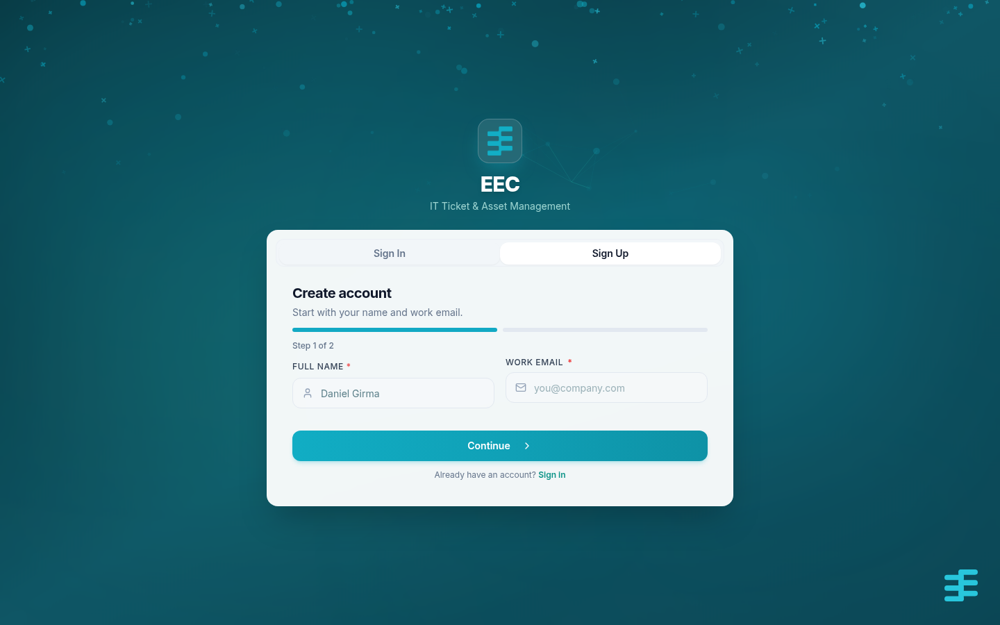
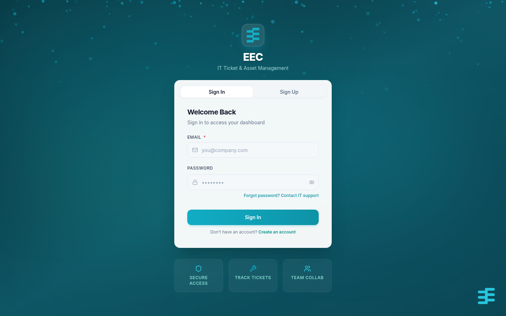

# 02 — Login Guide

**Document:** User Manual  
**System:** EEC IT Asset & Ticket Management System  
**Version:** 1.0

---

## 1. Create an account

1. Open the application URL in your browser.
2. Choose **Register** or **Create an account**.
3. Fill in:

   | Field | Required | Notes |
   |-------|----------|--------|
   | Full name | Yes | Shown on tickets and the user list |
   | Email | Yes | This is your login |
   | Password | Yes | At least 8 characters |
   | Confirm password | Yes | Must match |
   | Phone | No | Used for SMS |
   | Telegram username | No | Used if you later link Telegram |
   | Location | No | Building or branch, if listed |

4. Submit the form.

Your account is **Pending Approval**. You cannot sign in until a manager or Super Admin approves it. You should receive an in-app (and Telegram, if already linked later) notice when that happens.

If your organization created the account for you, skip registration and use the email and password they sent. Change the password after first login.

---

## 2. Sign in

1. Open the login page.
2. Enter **email** and **password**.
3. Click **Login**.

Successful login takes you to the **Dashboard**.

### Messages you may see

| Message (wording may vary) | What to do |
|----------------------------|------------|
| Account awaiting admin approval | Wait for approval; do not keep retrying with the same pending account |
| Registration not approved | The account was rejected; contact IT |
| Invalid credentials | Check email and password; use the same email you registered |

---

## 3. Sign out

Open your **profile avatar** (top right) and choose **Logout**, or go to **Settings** and sign out.

Signing out revokes the current session token on the server. Always sign out on a shared computer.

---

## 4. Change password

After you are signed in:

1. Go to **Settings → Security**.
2. Enter **current password**.
3. Enter **new password** (minimum 8 characters) and confirm it.
4. Save.

There is no self-service “forgot password” email flow in the current product. If you cannot sign in, ask an Admin or Super Admin to reset or recreate access.

---

## 5. Session notes

- Keep one browser tab set as your main session; if you are signed out automatically, sign in again.
- Use HTTPS in production so your password and session token are encrypted in transit.
- Do not share your password. Managers should never ask you to send it by chat or email.
