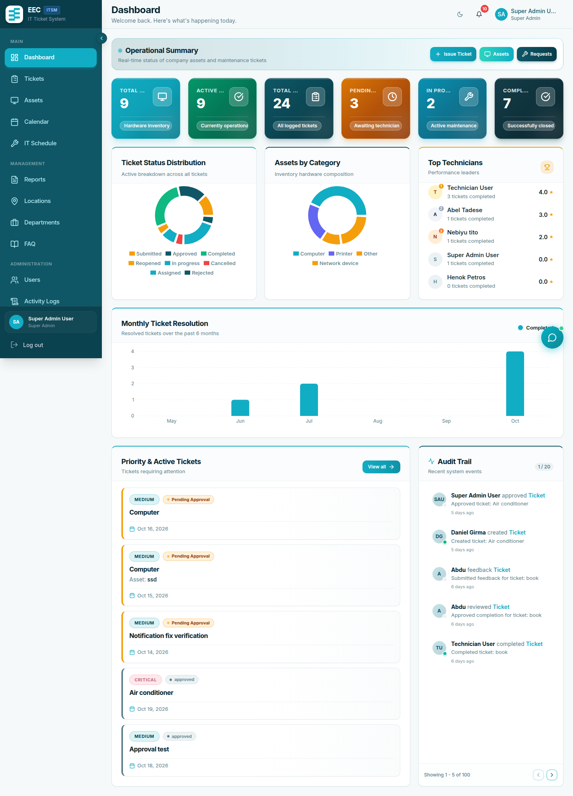
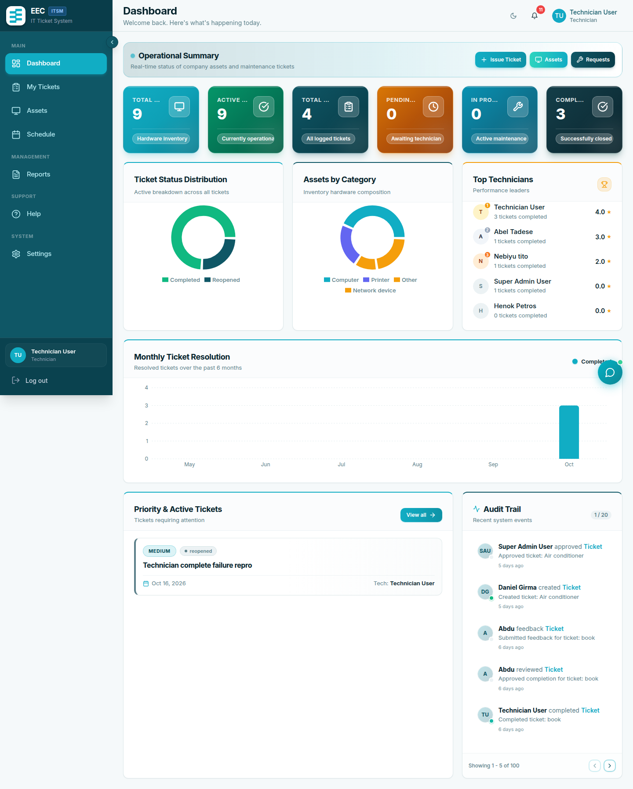
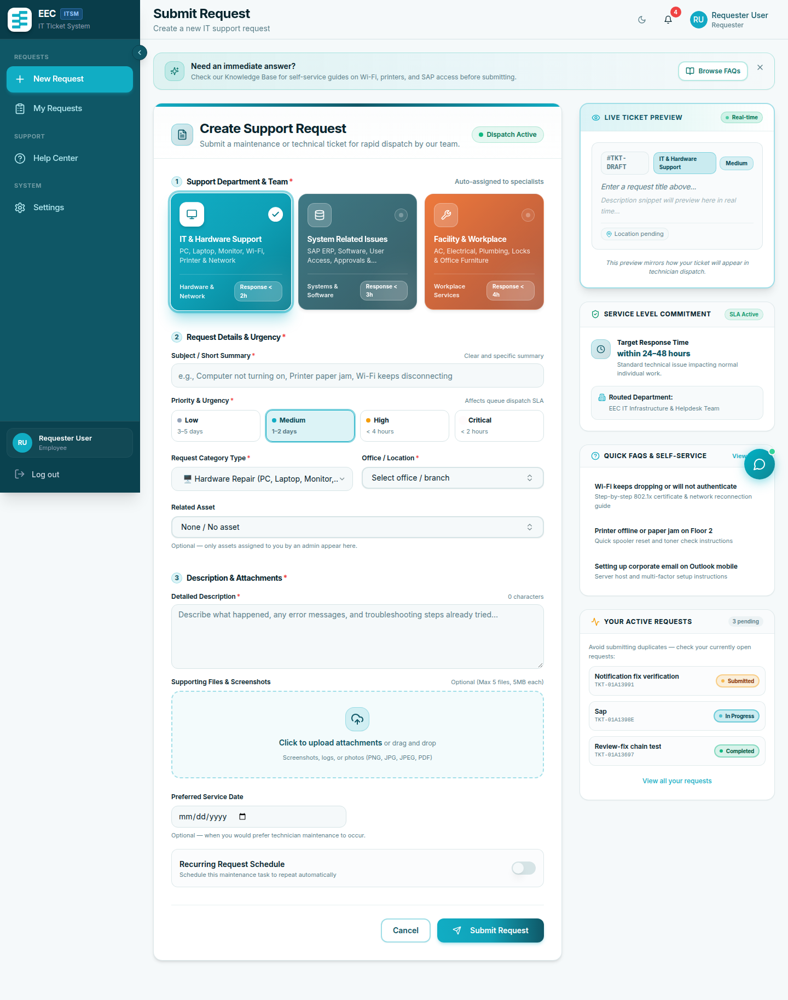
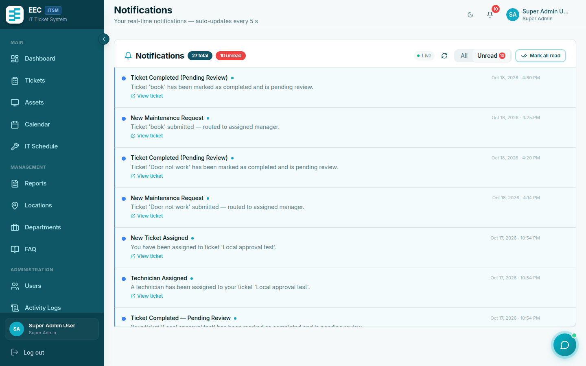
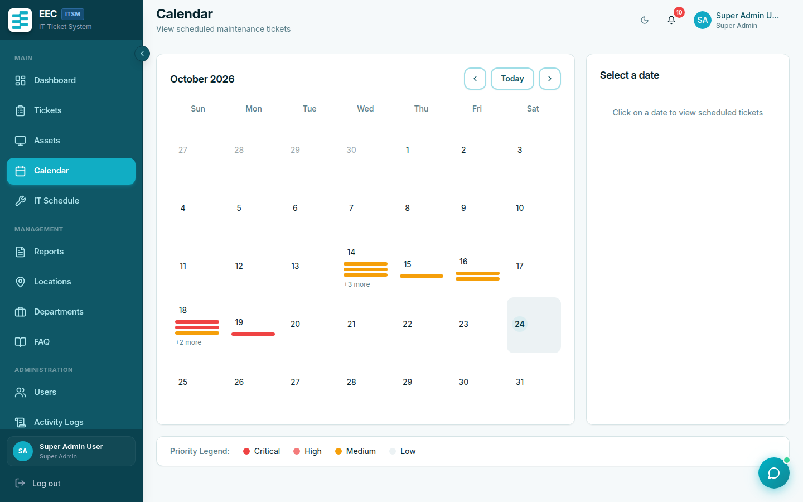

# 03 — Dashboard Guide

**Document:** User Manual  
**System:** EEC IT Asset & Ticket Management System  
**Version:** 1.0

---

## 1. After you sign in

The first screen is the **Dashboard** (`/`). It summarizes work that belongs to **your role**.

*Figure 3.1: Super Admin and Manager Dashboard with active maintenance metrics, SLA compliance charts, and system status widgets.*

*Figure 3.2: Technician Dashboard displaying assigned tickets, priority queues, and pending service tasks.*

*Figure 3.3: Requester Self-Service Portal displaying active requests, service status, and new request creation.*

Typical widgets:

| Widget | Who sees it | What it shows |
|--------|-------------|----------------|
| Ticket summary | Most users | Counts of active, pending, and completed tickets you can see |
| Recent tickets | Most users | Latest activity |
| Quick actions | Most users | Shortcut to submit a request or open tickets |
| Asset overview | Managers | Distribution of asset statuses |
| Performance metrics | Technicians and managers | Completion rates and averages |

Numbers depend on visibility rules: requesters see their own tickets, technicians see assigned work, managers see their department, Super Admins see everything.

---

## 2. Sidebar and header

**Left sidebar** — main navigation. Items appear only if your role is allowed to use them. Common entries:

| Menu | Typical path | Purpose |
|------|----------------|---------|
| Dashboard | `/` | Home |
| Requests / Tickets | `/tickets` or similar | List and open tickets |
| Assets | `/assets` | Asset register (managers) |
| Users | `/users` | Accounts (managers) |
| Locations | `/locations` | Sites |
| Departments | `/departments` | Organization units |
| Schedules | `/schedules` | Preventive maintenance |
| Calendar | `/calendar` | Scheduled work |
| FAQs | `/faqs` | Knowledge base editor (managers) |
| Help | `/help` | Published articles |
| Reports | `/reports` | Charts and CSV export |
| Activity Logs | `/activity-logs` | Audit trail |
| Notifications | `/notifications` | Full message list |
| Settings | `/settings` | Profile, password, Telegram, theme |

**Header**

- **Bell** — unread in-app notifications. Click to open the panel; use **Mark all as read** when needed.
- **Avatar** — profile and logout.
- **Theme** — light or dark (also under Settings).

On a phone, the sidebar collapses; use the menu icon to open it.

---

## 3. Notifications page

*Figure 3.4: In-App Notifications Center displaying ticket state transitions and alert history.*

Open **Notifications** for the full list. Click a row to open the related ticket or user (and mark it read). Events include:

- New registration (managers / Super Admins)
- Account approved (you)
- Ticket submitted, approved, rejected, assigned, completed, reopened
- Feedback received (managers; technicians get rating, not private comments)

---

## 4. Calendar

*Figure 3.5: Service Schedule Calendar with month/week views for planned preventive maintenance.*

**Calendar** shows scheduled maintenance tickets and preventive schedules in month or week view. Use it to plan upcoming work; opening an event still happens from the ticket or schedule screens.

---

## 5. Empty and loading states

- While data loads you may see skeleton placeholders.
- If a list is empty, submit a request (requester) or wait for assignment (technician).
- If you open a URL you are not allowed to use, the app redirects or shows a forbidden message. Use the sidebar instead of typing admin URLs.
