# 04 — Feature Guides

**Document:** User Manual  
**System:** EEC IT Asset & Ticket Management System  
**Version:** 1.0

---

## Table of Contents

1. [Requester: tickets](#1-requester-tickets)
2. [Technician: assigned work](#2-technician-assigned-work)
3. [Manager: workflow](#3-manager-workflow)
4. [Assets, locations, departments](#4-assets-locations-departments)
5. [Users](#5-users)
6. [Schedules](#6-schedules)
7. [Reports and activity logs](#7-reports-and-activity-logs)
8. [Help Center and chatbot](#8-help-center-and-chatbot)
9. [Settings and Telegram](#9-settings-and-telegram)
10. [Priority and category cheat sheet](#10-priority-and-category-cheat-sheet)

---

## 1. Requester: tickets

### Submit a request

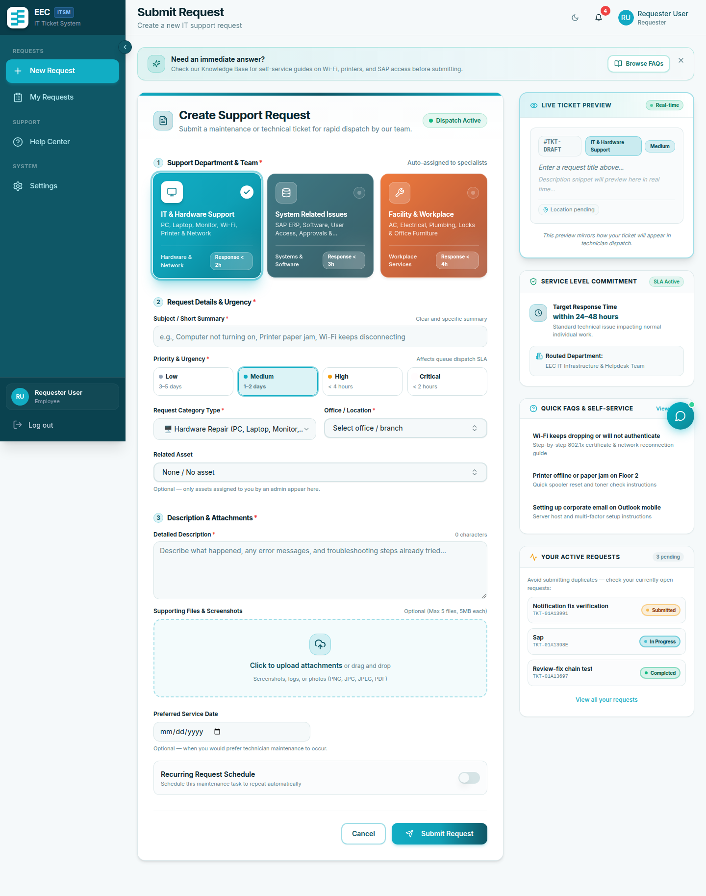

*Figure 4.1: Requester ticket submission form and active requests tracking view.*

1. Open **Requests** (or **New Request** on the dashboard).
2. Complete the form:

   | Field | Required | Notes |
   |-------|----------|--------|
   | Title | Yes | Short summary |
   | Type | Yes | Maintenance, Repair, Installation, Inspection, Other |
   | Support category | No | IT Support, SAP/ERP, or General — routes to the right team (defaults to General) |
   | Priority | No | Defaults to Medium |
   | Scheduled date | Yes | When the work is needed |
   | Description | No | Details |
   | Asset | No | Affected equipment |
   | Attachments | No | Up to 5 files, 5 MB each (images or PDF) |
   | Recurring | No | Daily, weekly, monthly, quarterly, or yearly |

3. Submit.

**Limit:** at most **3 active requests** at once. Finish or cancel existing ones before opening more.

### Track status

Open **Requests** and click a row for diagnosis, actions taken, parts, and timeline.

### Review completion

When status is **Completed – Pending Review**:

1. Open the ticket.
2. Choose **Approve Completion** if the issue is solved, or **Request Rework** with notes if not.

### Feedback

After **Completed**, open the ticket → **Submit Feedback** → 1–5 stars and optional comment. Comments are **visible to managers only**, not to technicians.

### Cancel

You can cancel your own tickets that are still submitted or reopened, when the button is shown.

---

## 2. Technician: assigned work

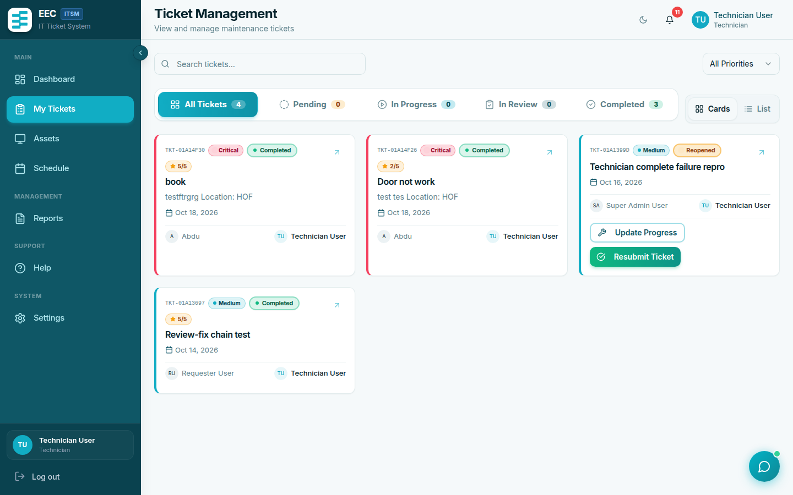

*Figure 4.2: Technician ticket queue with category filters, priority indicators, and action triggers.*

1. Open **Tickets**. You see work assigned to you. Filter by status, priority, or category.
2. On an **Assigned** ticket, click **Start Work**. Status becomes **In Progress** and start time is stored.
3. Use **Update Progress** for diagnosis, actions taken, spare parts, and estimated duration (minutes).
4. **Mark as Complete**: required **actions taken**; optional spare parts and actual duration. Status becomes **Completed – Pending Review**.
5. Open **Reports** for ticket and asset statistics you are allowed to see.

You cannot approve, reject, or assign tickets. If a ticket is reopened, continue work from **In Progress** / **Reopened** as the form allows.

---

## 3. Manager: workflow

### Approve or reject

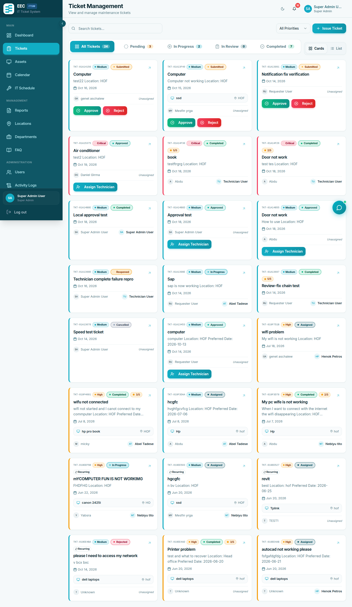

*Figure 4.3: Comprehensive ticket listing with support categories, status chips, and technician assignments.*

1. Open **Tickets** and a **Submitted** item.
2. **Approve**, or **Reject** with a **required reason**.

The requester is notified (in-app and SMS if configured).

### Assign a technician

On **Approved** or **Submitted** tickets, **Assign Technician**. The list is limited by support category:

- SAP → SAP technicians
- IT Support → IT Support technicians
- General → general / facility technicians

### Review completion and transfer

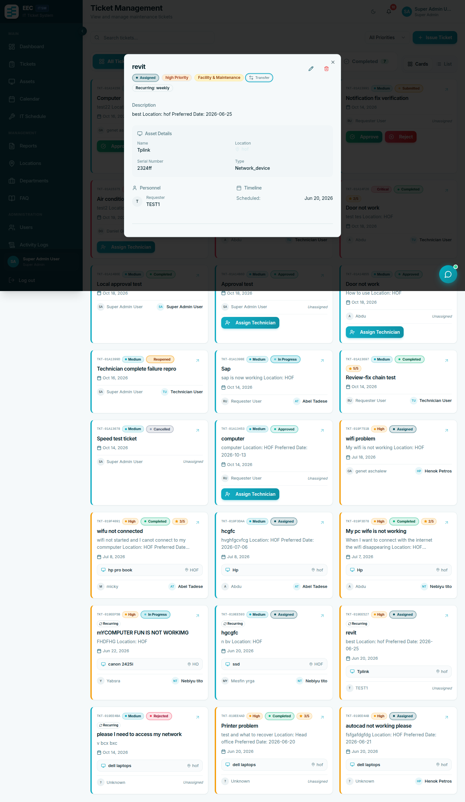

*Figure 4.4: Ticket detail interface featuring technician assignment, status transitions, resolution notes, and activity timeline.*

- **Approve Completion** or **Reopen** with notes on **Completed – Pending Review**.
- **Transfer** moves the ticket to another support category and re-routes it to that manager. Optional reason, max 500 characters.

Super Admins follow the same steps for every department.

---

## 4. Assets, locations, departments

**Assets** (`/assets`) — managers:

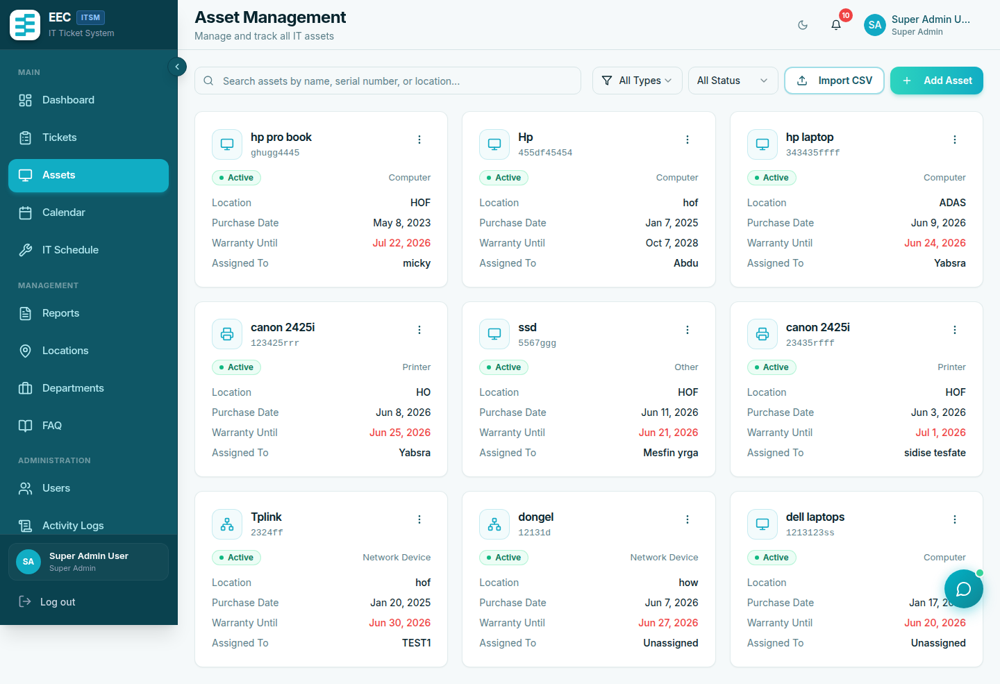

*Figure 4.5: Centralized asset register showing serial numbers, equipment types, operational status, and assignment tracking.*

- View, add, edit, delete
- Import CSV with columns: `name`, `type`, `serial_number`, `purchase_date`, `location`, `status` (optional `warranty_expiry`, `notes`)
- Types: computer, printer, server, network_device, other
- Statuses: active, maintenance, retired, disposed

**Locations** and **Departments** — create, edit, delete, or CSV import (`name` column). Profiles can be tied to a location.

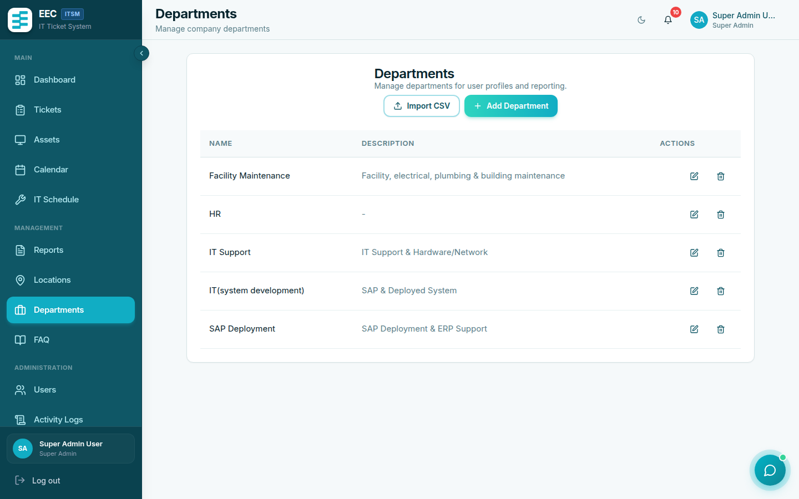

*Figure 4.6: Organizational department configuration.*

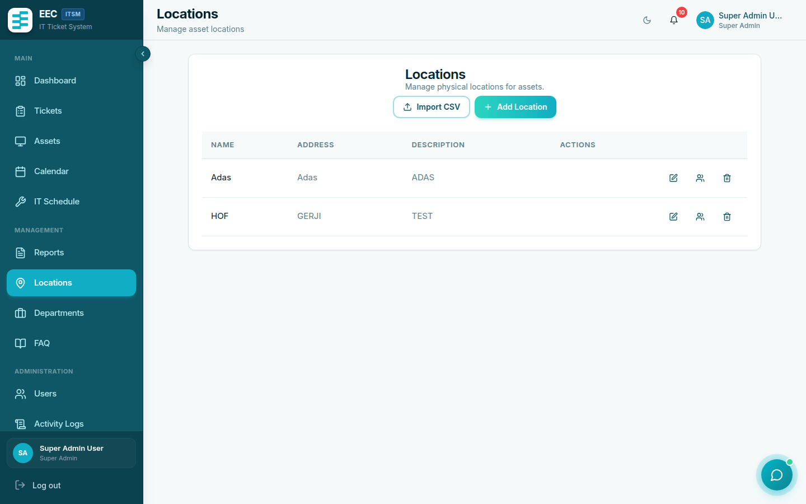

*Figure 4.7: Facility and building location directory.*

---

## 5. Users

**Users** (`/users`) — managers and Super Admins:

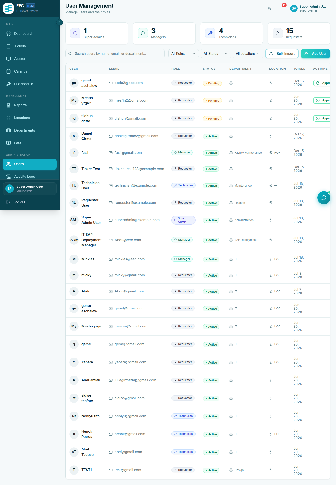

*Figure 4.8: User administration dashboard with pending approval queue, role assignments, and department filters.*

- Filter **Pending** and **Approve** or **Reject** self-registered accounts
- **Add User** (admin-created accounts are active immediately)
- Admins create **technicians in their own support domain** only
- Only Super Admins create **Admin** or **Super Admin** accounts
- Change role and profile (including **support category** on manager accounts — required for correct ticket routing)

After a fresh install, change the default demo passwords (`superadmin@example.com`, `admin@example.com`, and others using `password`).

---

## 6. Schedules

**Schedules** (`/schedules`) — preventive maintenance on an asset:

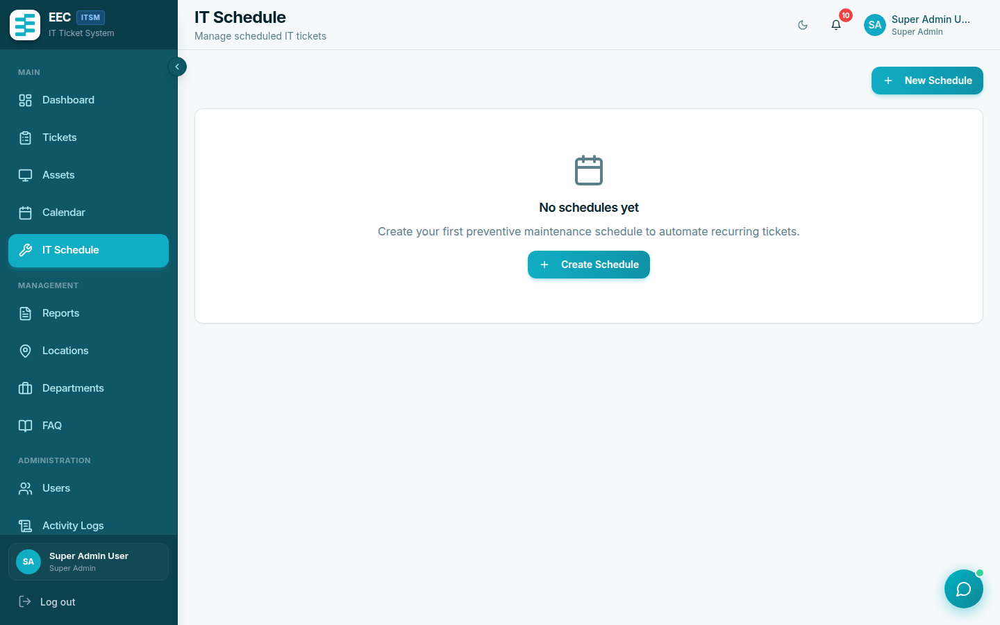

*Figure 4.9: Recurring preventive maintenance schedules linked to registered assets.*

- Title, description, type, frequency (daily, weekly, monthly, quarterly, yearly)
- Next / last run dates
- Active flag

Tickets are generated when the server command `maintenance:check-schedules` runs. Ask operations if schedules are not producing tickets.

---

## 7. Reports and activity logs

**Reports** (`/reports`):

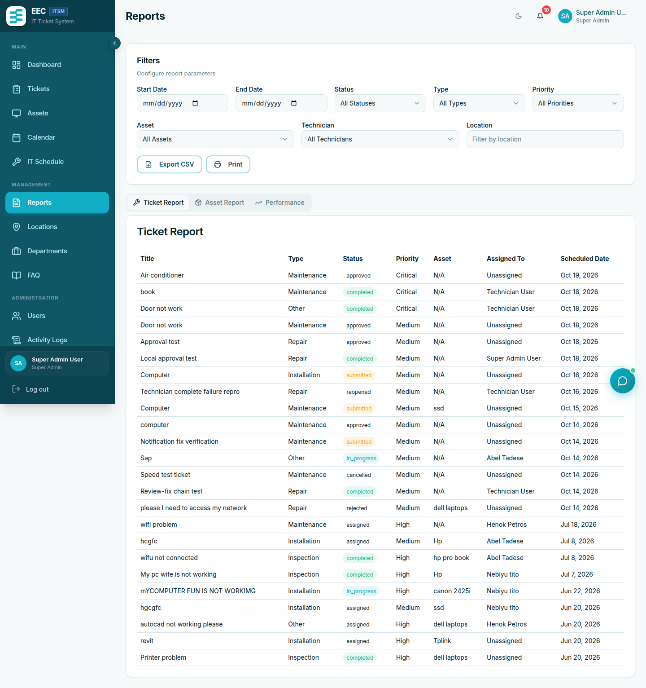

*Figure 4.10: Service performance reports, resolution metrics, and CSV export utility.*

- Ticket, asset, and performance views
- Filters: date range, status, type, priority, technician
- **Export CSV** for tickets and assets

**Activity Logs** (`/activity-logs`):

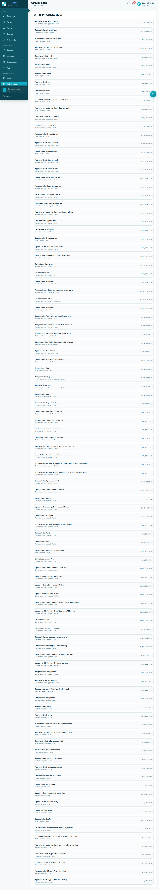

*Figure 4.11: Audit log tracking user actions, entity updates, and security events.*

Timestamped audit of create/update/delete and status changes. Super Admins should review after user or role changes.

---

## 8. Help Center and chatbot

**Help** (`/help`) lists **published** FAQ articles. Search by keyword.

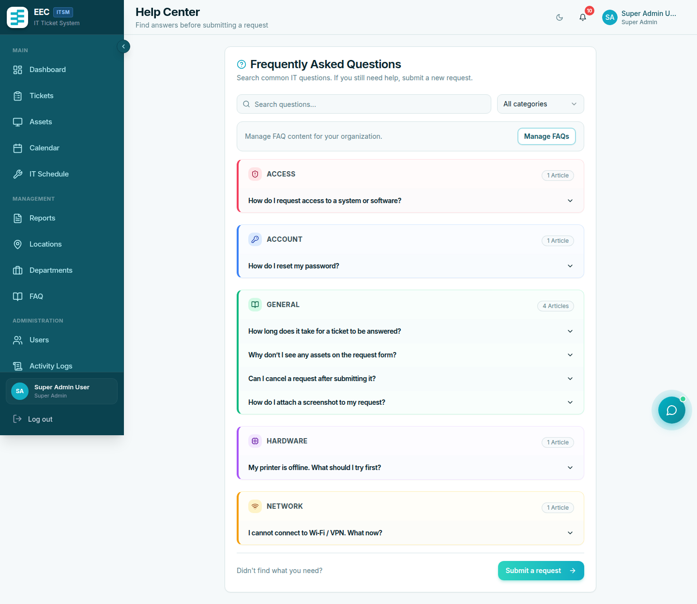

*Figure 4.12: Staff self-service Help Center with keyword search and categorized support articles.*

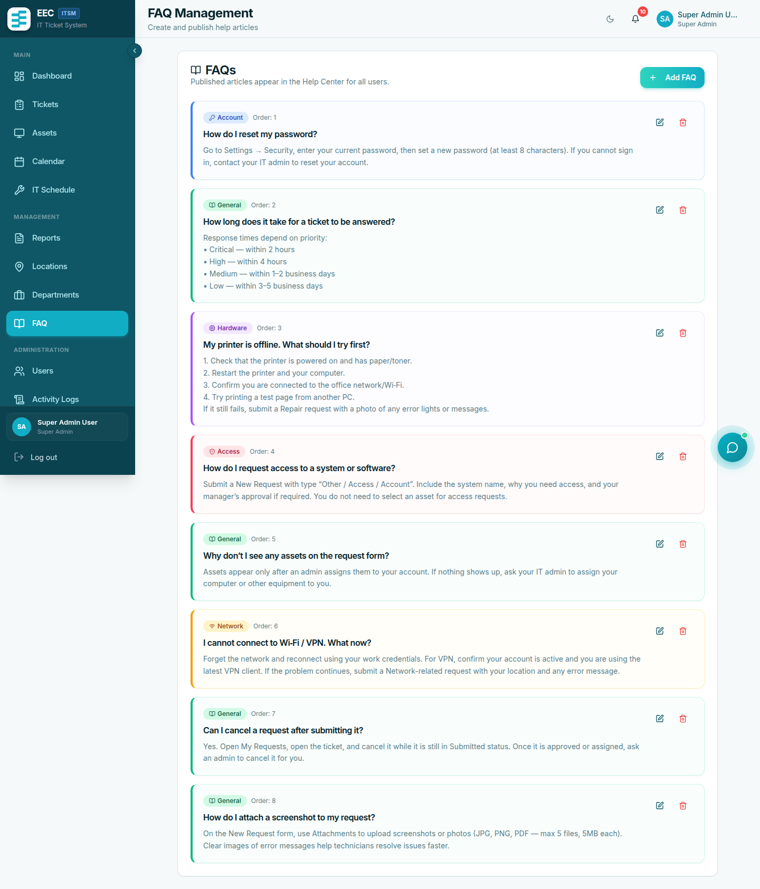

*Figure 4.13: Knowledge base article editor for managers.*

Managers maintain articles under **FAQs** (title, body, category, order, published flag). Unpublished articles are hidden from staff.

The **chat bubble** (bottom right) is a **keyword search** over published FAQs (up to three matches). It does **not** call an external AI. If nothing matches, submit a ticket.

Example questions: “How do I connect to the VPN?”, “Printer not working”, “Reset my password”.

---

## 9. Settings and Telegram

**Settings** (`/settings`):

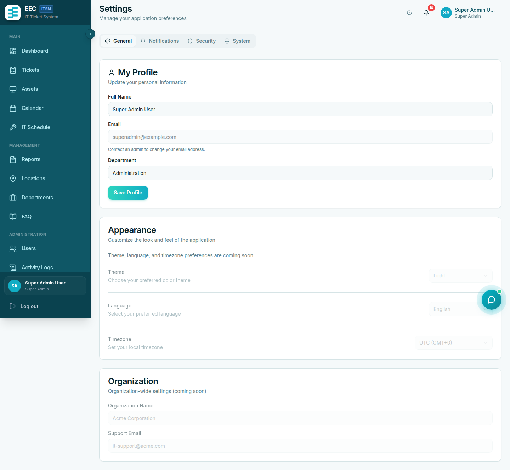

*Figure 4.14: User settings panel for profile updates, security password reset, theme selection, and Telegram linking.*

- Profile: name, phone, department, location, avatar, Telegram username
- Security: password
- Theme: light / dark
- SMS uses the **phone number** on the profile

### Link Telegram

1. Settings → Telegram → **Link Telegram Account**.
2. Open the deep link within **15 minutes**.
3. Send `/start` to the bot if prompted.
4. Wait for confirmation.

**Unlink** from the same screen. Telegram messages cover approval, submission (managers), assignment, and completion events when the bot is configured.

---

## 10. Priority and category cheat sheet

| Priority | Use when |
|----------|----------|
| Low | Can wait several days |
| Medium | Normal business impact |
| High | Significant productivity impact |
| Critical | Outage or halted operations |

| Category | Use when |
|----------|----------|
| IT Support | Hardware, network, OS, printers |
| SAP / ERP | SAP or other business applications |
| General | Facilities and non-IT workplace issues |
